# 图像融合与多模态感知数据集目录

原创：公众号@多模态信息融合

[可搜索的网页导航](https://mmifusion.github.io/Datasets/) · [项目介绍](../README.md)

收录包含数据集、衍生版本、评测基准与资源集合；开放状态及使用许可以原始资源为准。

## 红外与可见光及相关多模态

### TNO数据集

**标签：** 图像融合：经典与基础数据

**发表团队：** Alexander Toet（TNO；数据页更新时间不等于论文发表年份）

**论文题目：** The TNO Multiband Image Data Collection

**发表：** Data Brief 2017

**下载链接：** https://figshare.com/articles/dataset/TNO_Image_Fusion_Dataset/1008029

TNO多波段图像集目前包含三个独立的图像集：TNO图像融合数据集、Kayak图像融合序列（第一部分和第二部分）以及TRICLOBS动态多波段图像数据集。TNO图像融合数据集包含不同军事和监视场景的增强视觉、近红外和长波红外夜间图像，展示了不同背景下的各种物体和目标。多模态的Kayak图像融合序列包含配准的视觉、近红外和长波红外图像序列，展示了在复杂海上背景中接近的三艘皮划艇。TRICLOBS动态多波段图像数据集包含城市环境中动态监视场景的配准视觉、近红外和长波红外运动序列。为了支持开发或实现逼真的色彩重映射程序，该数据集还包含每个场景的彩色照片。作者计划在获得新图像时逐步扩展该数据集的收集。

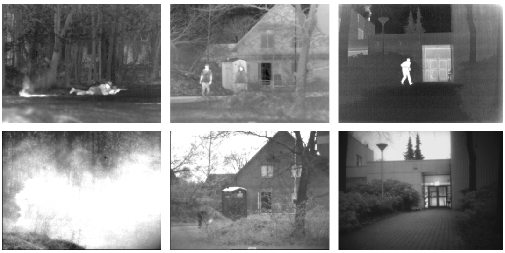

[在网页中查看](https://mmifusion.github.io/Datasets/#dataset=tno)

---

### RoadScene数据集

**标签：** 图像融合：经典与基础数据

**发表团队：** 武汉大学等联合团队 @Han Xu、Jiayi Ma、Junjun Jiang、Xiaojie Guo、Haibin Ling

**论文题目：** U2Fusion: A Unified Unsupervised Image Fusion Network

**发表：** TPAMI 2022

**下载链接：** https://github.com/hanna-xu/RoadScene

该数据集有 221 对配准的 Vis 和 IR 图像对，其中包含丰富的场景，如道路、车辆、行人等。这些图像是 FLIR 视频中极具代表性的场景。对原始 IR 图像中的背景热噪声进行预处理，准确对齐 Vis 和 IR 图像对，并切出确切的配准区域以形成此数据集。

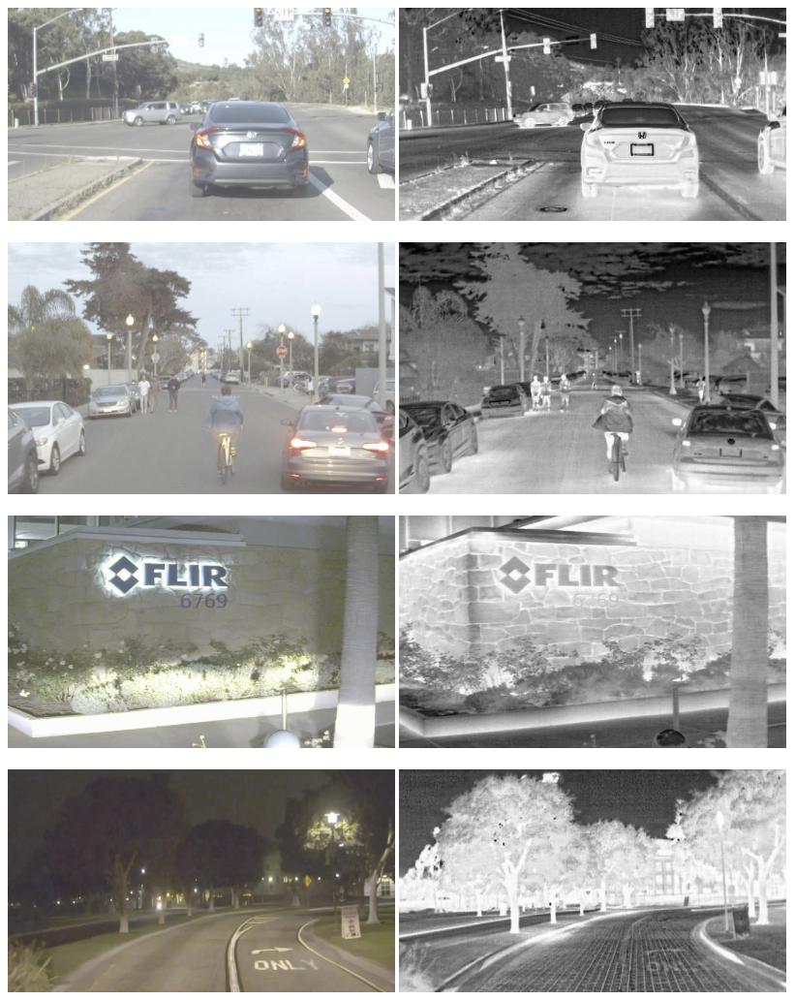

[在网页中查看](https://mmifusion.github.io/Datasets/#dataset=roadscene)

---

### MSRS数据集

**标签：** 图像融合：经典与基础数据

**发表团队：** 武汉大学马佳义团队 @Linfeng Tang、Jiteng Yuan、Hao Zhang、Xingyu Jiang、Jiayi Ma

**论文题目：** PIAFusion: A progressive infrared and visible image fusion network based on illumination aware

**发表：** Inf. Fusion 2022

**下载链接：** https://github.com/Linfeng-Tang/MSRS

作者基于 MFNet 数据集构建了一个新的多光谱数据集，用于红外和可见光图像融合。MFNet 数据集包含 1,569 对图像（820 对在白天拍摄，749 对在夜间拍摄），空间分辨率为 480 × 640。然而，MFNet 数据集中存在许多未对齐的图像对，并且大多数红外图像信噪比低且对比度低。为此，作者首先通过移除 125 对未对齐的图像对，收集了 715 对白天图像和 729 对夜间图像。此外，利用基于暗通道先验的图像增强算法来优化红外图像的对比度和信噪比。因此，发布的新的多光谱道路场景（MSRS）数据集包含 1,444 对高质量的对齐红外和可见光图像。

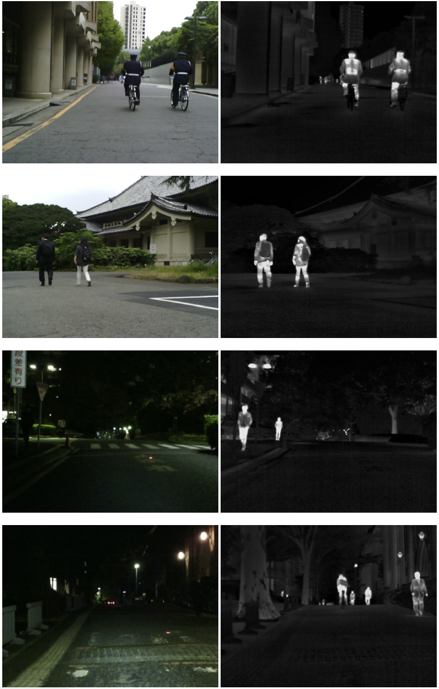

[在网页中查看](https://mmifusion.github.io/Datasets/#dataset=msrs)

---

### LLVIP数据集

**标签：** 图像融合：经典与基础数据

**发表团队：** 北京邮电大学 @Xinyu Jia、Chuang Zhu、Minzhen Li、Wenqi Tang、Wenli Zhou

**论文题目：** LLVIP: A Visible-infrared Paired Dataset for Low-light Vision

**发表：** ICCVW 2021

**下载链接：** https://github.com/bupt-ai-cz/LLVIP

LLVIP是一个专为低光照视觉任务设计的可见光-红外配对数据集，包含16,836对（2021年会议论文口径；后续预印本报告15,488对）严格时空对齐的图像，采集于极暗环境（晚6点至10点），使用HIKVISION双目摄像头（可见光分辨率1920×1080，红外1280×720），注册后统一为1080×720分辨率以确保视场一致。该数据集通过红外图像反向映射标注可见光图像中的行人，覆盖26个场景的丰富行人目标（中距离中等尺寸），支持图像融合、低光行人检测及图像转换等任务。LLVIP在规模（16,836对（2021年会议论文口径；后续预印本报告15,488对））、低光条件、时空对齐精度及行人标注密度（每对均含行人）上具有较大规模和较高配准精度，适用于低光条件下的算法评测。

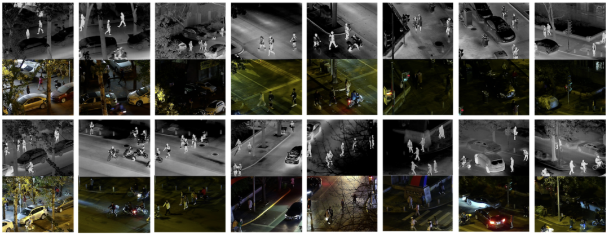

[在网页中查看](https://mmifusion.github.io/Datasets/#dataset=llvip)

---

### M3FD数据集

**标签：** 图像融合：经典与基础数据

**发表团队：** 大连理工大学-Risheng Liu团队：Jinyuan Liu、Xin Fan、Zhanbo Huang、Guanyao Wu、Risheng Liu、Wei Zhong、Zhongxuan Luo

**论文题目：** Target-aware Dual Adversarial Learning and a Multi-scenario Multi-Modality Benchmark to Fuse Infrared and Visible for Object Detection

**发表：** CVPR 2022

**下载链接：** https://github.com/JinyuanLiu-CV/TarDAL

数据采集系统包含一个双目光学相机和一个双目红外传感器，数据采集地点包括大连理工大学校园、大连金石滩国家旅游度假区和大连金州区的主要道路。数据集共包含8400张图像用于融合、检测和基于融合的检测，其中600张为独立场景的融合图像。作者仓库列出4,200对用于融合和检测，另有300对独立场景用于融合；不同论文的统计口径可能不同。图像格式为24位灰度位图（红外）和24位彩色位图（可见光），图像尺寸主要为1024 x 768像素。所有图像对均经过配准，可见光图像通过系统内部参数校准，红外图像通过单应矩阵进行人工失真处理。数据集共标注了34407个目标，涵盖6种类别：行人、汽车、公交车、摩托车、路灯和卡车。

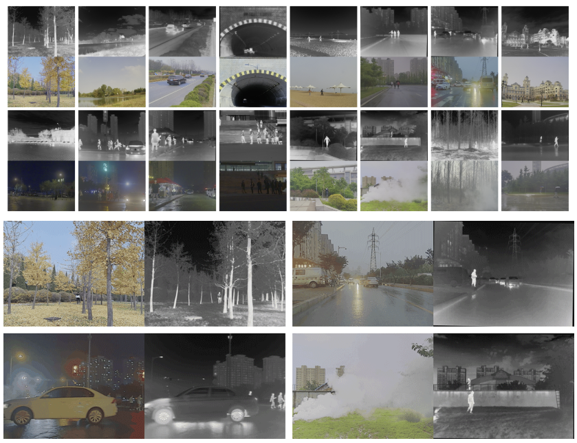

[在网页中查看](https://mmifusion.github.io/Datasets/#dataset=m3fd)

---

### FMB数据集

**标签：** 图像融合：经典与基础数据

**发表团队：** 大连理工大学-Risheng Liu团队：Jinyuan Liu、Zhu Liu、Guanyao Wu、Long Ma、Risheng Liu、Wei Zhong、Zhongxuan Luo、Xin Fan

**论文题目：** Multi-interactive Feature Learning and a Full-time Multi-modality Benchmark for Image Fusion and Segmentation

**发表：** ICCV 2023

**下载链接：** https://github.com/JinyuanLiu-CV/SegMiF

FMB（Full-time Multi-modality Benchmark）是一个面向全天候复杂场景的多模态基准数据集，包含1500对严格时空配准的红外与可见光图像（分辨率800×600），覆盖雾天、暴雨、低光等多种极端环境。数据集通过智能双目成像系统采集，确保图像对的高精度对齐，并提供像素级标注的14类语义标签（如道路、行人、车辆、交通标志等），标注覆盖率高达98.16%，适用于自动驾驶与语义理解任务。

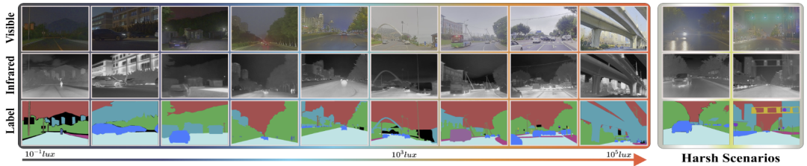

[在网页中查看](https://mmifusion.github.io/Datasets/#dataset=fmb)

---

### VIFB数据集基准

**标签：** 图像融合：经典与基础数据

**发表团队：** 上海交通大学、帝国理工学院联合团队 @Xingchen Zhang、Ping Ye、Gang Xiao（按论文发表时署名机构）

**论文题目：** VIFB: A Visible and Infrared Image Fusion Benchmark

**发表：** CVPRW 2020

**下载链接：** https://github.com/xingchenzhang/VIFB

该论文选择 21 对图像构建 VIFB 测试集，旨在解决可见光与红外图像融合领域缺乏统一代码库和评估标准的问题。尽管 TNO 和 VLIRVDIF 等数据集拥有不少图像对，但它们缺少代码库、评估指标和结果，难以评估技术水平。VIFB 通过提供涵盖室内、室外、低照度、过度曝光等多种环境和工作条件的 21 对可见光与红外图像，用于测试图像融合算法的泛化能力。这些图像来自互联网和融合跟踪数据集，经过配准以确保融合能够成功执行，并且具有不同的分辨率，如 320×240、630×460、512×184 和 452×332。

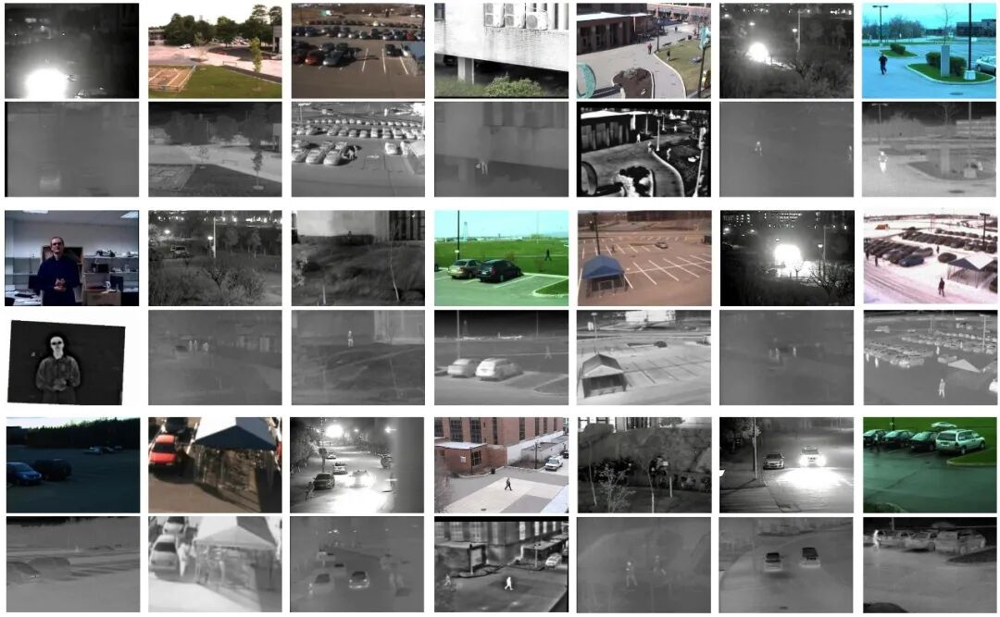

[在网页中查看](https://mmifusion.github.io/Datasets/#dataset=vifb)

---

### AWMM-100k数据集

**标签：** 退化恢复、增强与融合

**发表团队：** 佛山大学-李小松团队：Xilai Li、Wuyang Liu、Xiaosong Li、Fuqiang Zhou、Huafeng Li、Feiping Nie

**论文题目：** All-weather multi-modality image fusion: Unified framework and 100k benchmark

**发表：** Inf. Fusion 2026

**下载链接：** https://github.com/ixilai/AWFusion

现有的MMIF数据集在恶劣天气场景的覆盖上不够全面。为了解决这一问题，作者引入了AWMM-100k，这是一个基准数据集，通过从RoadScene、MSRS、M3FD和LLVIP中选取样本，并经过受控的退化处理以模拟恶劣天气条件而构建。结合使用配备高分辨率可见光和热成像相机的DJI M30T无人机捕获的真实数据，AWMM-100k包含了超过187,699张图像，涵盖雨、雾和雪等天气，每种天气条件又分为重度、中度和轻度三个强度等级。该数据集支持在挑战性天气条件下的多模态图像融合研究，同时也适用于去雾、去雨和去雪等图像恢复任务。作者非常感谢原始数据集的贡献。

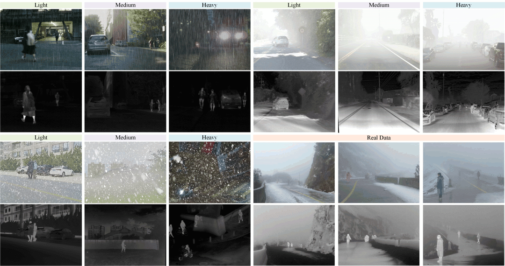

[在网页中查看](https://mmifusion.github.io/Datasets/#dataset=awmm-100k)

---

### AWMM-Text数据集

**标签：** 退化恢复、增强与融合

**发表团队：** 佛山大学、中国矿业大学（北京）、昆明理工大学联合团队 @Xilai Li、Huichun Liu；作者为 Xilai Li、Huichun Liu、Xiaosong Li*、Tao Ye、Zhenyu Kuang、Huafeng Li，其中 Xilai Li 与 Huichun Liu 为共同第一作者。

**论文题目：** AWM-Fuse: Multi-Modality Image Fusion for Adverse Weather via Global and Local Text Perception

**发表：** TIP 2026

**下载链接：** https://ixilai.github.io/AWMM-100K/

AWMM-Text 是在 AWMM-100K 基础上进一步构建的恶劣天气红外-可见光图像—文本多模态基准，主要为文本引导的红外与可见光图像融合研究提供语义监督。数据集为 8,500 对多模态图像提供成对的文本描述及对应清晰图像，其中包含两种层级的文本标注：一类是由 BLIP 生成的全局描述，用于概括整体场景语义和天气退化类型；另一类是由 ChatGPT-4 生成的详细描述，用于描述具体目标、局部区域以及红外与可见光之间的信息差异。官方在生成文本后进行了人工筛选，并按照明确的通过/不通过规则抽查约 30% 的文本，以提高文本标注质量。该数据集主要适用于视觉-语言引导的恶劣天气图像融合、跨模态语义感知以及图像恢复等研究。

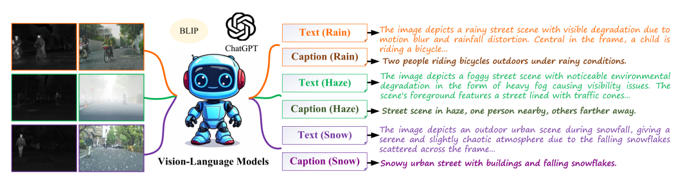

[在网页中查看](https://mmifusion.github.io/Datasets/#dataset=awmm-text)

---

### DDL-12数据集（多模态多退化／可控融合）

**标签：** 退化恢复、增强与融合 ｜ 文本引导  ｜  合成退化

**发表团队：** 武汉大学、澳门科技大学、哈尔滨工业大学联合团队 @Linfeng Tang、Yeda Wang、Zhanchuan Cai、Junjun Jiang、Jiayi Ma

**论文题目：** ControlFusion: A Controllable Image Fusion Network with Language-Vision Degradation Prompts

**发表：** NeurIPS 2025

**论文链接：** https://papers.nips.cc/paper_files/paper/2025/hash/ab96f6d04380de817ed3a1bad9b92f2e-Abstract-Conference.html

**下载链接：** Google Drive 数据集 项目代码： https://github.com/Linfeng-Tang/ControlFusion

DDL-12 是 ControlFusion 论文构建的多模态复合退化数据集，面向红外与可见光图像的退化恢复和可控融合。论文采用退化成像模型模拟复杂退化，设置 12 类退化和 4 个强度等级；包含约 48,000 对训练图像和 4,800 对测试图像。该数据用于研究退化提示引导的恢复与融合，不应理解为全部为新采集的真实退化图像。

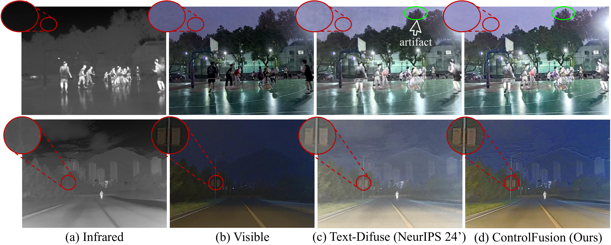

[在网页中查看](https://mmifusion.github.io/Datasets/#dataset=ddl-12)

---

### MSD数据集 (真实场景·极端天气·多退化·恢复+融合)

**标签：** 退化恢复、增强与融合

**发表团队：** 北京理工大学-岳裕丰团队@Luojie Yang、Meng Yu、Lijin Fang、Yi Yang、Yufeng Yue

**论文题目：** CDMFusion: RGB-T Image Fusion Based on Conditional Diffusion Models via Few Denoising Steps in Open Environments

**发表：** ICRA 2025

**下载链接：** https://github.com/yangluojie/CDMFusion

MSD 数据集（Multi-Scene Degradation Dataset）是作者面向真实复杂环境下的红外–可见光图像融合任务构建的多场景退化数据集，旨在弥补现有数据集场景单一、退化类型不足的问题。该数据集共包含 208 对精确配准的 IR–VIS 图像，覆盖城市道路、居民区、校园、森林等多种真实拍摄环境，并系统性地包含 弱光、雾霾、阴雨、逆光、噪声干扰等多类型自然退化，从而更真实地反映跨模态融合任务在户外场景面临的光照变化与成像质量下降问题。与常规的清晰图像数据集不同，MSD 特别强调模态差异下的 局部结构损伤、纹理缺失与光照不一致性，为评估融合算法在复杂退化场景下的稳健性和泛化能力提供了更具挑战性和代表性的基准测试平台。

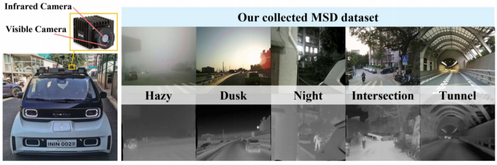

[在网页中查看](https://mmifusion.github.io/Datasets/#dataset=msd)

---

### Airsim-VID数据集

**标签：** 退化恢复、增强与融合

**发表团队：** 北京理工大学-Yufeng Yue | 岳裕丰团队 @Meng Yu、Te Cui、Haoyang Lu、Yufeng Yue

**论文题目：** VIFNet: An end-to-end visible–infrared fusion network for image dehazing

**发表：** Neurocomputing 2024

**下载链接：** https://github.com/mengyu212/VIFNet_dehazing

AirSim-VID。在模拟数据集方面，我们提出了一个基于 AirSim 的雾天可见光–红外图像数据集。AirSim 是一个面向自动驾驶车辆的高保真仿真平台，能够在不同雾浓度条件下提供实时的真实标签和配对图像。数据集的生成流程如下：首先，我们选用官方提供的场景 AirSimNH（一个小型城市街区）作为仿真环境进行数据采集。接着，在无人车前部的同一位置安装可见光相机和红外相机。车辆在指定里程内行驶时，每隔 5 米采集一次图像。最终，我们构建了一个包含 2310 组对齐的雾天/晴天/红外图像对 的数据集，其中每组图像对应 三种不同的雾浓度系数。

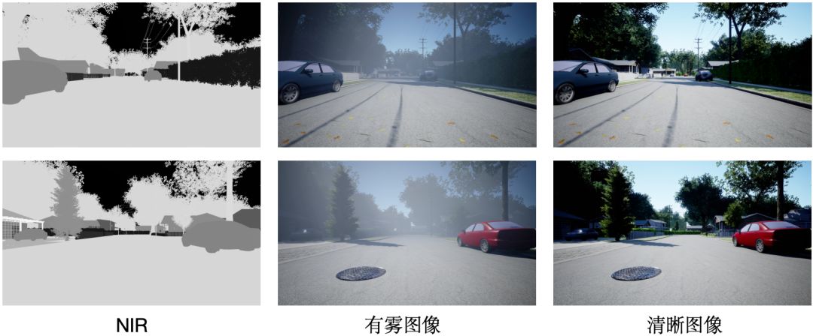

[在网页中查看](https://mmifusion.github.io/Datasets/#dataset=airsim-vid)

---

### DeMMI-RF数据集

**标签：** 退化恢复、增强与融合

**发表团队：** 东南大学-Pengfei Zhu团队@Yiming Sun、Xin Li、Pengfei Zhu、Qinghua Hu、Dongwei Ren、Huiying Xu、Xinzhong Zhu

**论文题目：** Task-Gated Multi-Expert Collaboration Network for Degraded Multi-Modal Image Fusion

**发表：** ICML 2025

**下载链接：** https://github.com/LeeX54946/TG-ECNet

本文提出的大规模退化多模态图像恢复与融合数据集 DeMMI-RF，专为评估在多种真实退化条件下的图像恢复与融合性能而设计。该数据集包含 超过3万对红外与可见光图像，涵盖 噪声、模糊、雾霾与条纹噪声 等多种复杂退化类型，并同时覆盖地面与无人机拍摄视角，具有广泛的应用代表性。DeMMI-RF 共包括 26631组训练数据 和 9895组测试数据，为退化图像融合任务提供了统一且权威的基准平台，有助于推动多退化、多模态图像处理领域的研究与模型评估发展

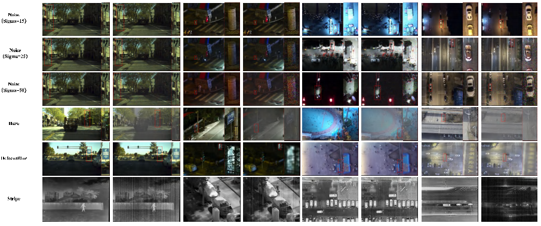

[在网页中查看](https://mmifusion.github.io/Datasets/#dataset=demmi-rf)

---

### IVOE数据集

**标签：** 退化恢复、增强与融合

**发表团队：** 浙江工业大学牵头，联合浙江树人学院、香港大学团队 @Zhiwei Wang、Defeng He、Li Zhao、Xiaoqin Zhang、Yuxing Li、Edmund Y. Lam，其中 Defeng He 为通讯作者；Zhiwei Wang 同时为香港大学访问博士生

**论文题目：** EPOFusion: Exposure aware Progressive Optimization Method for Infrared and Visible Image Fusion

**发表：** arXiv 2026（预印本）

**下载链接：** https://warren-wzw.github.io/EPOFusion/

IVOE 面向过曝光条件下的红外与可见光融合，包含真实过曝光测试数据和合成训练数据。真实部分有 447 对配准图像，提供 3,722 个目标检测框及像素级语义分割标注，检测类别包括行人、自行车和汽车。数据可用于融合、检测和分割等任务。

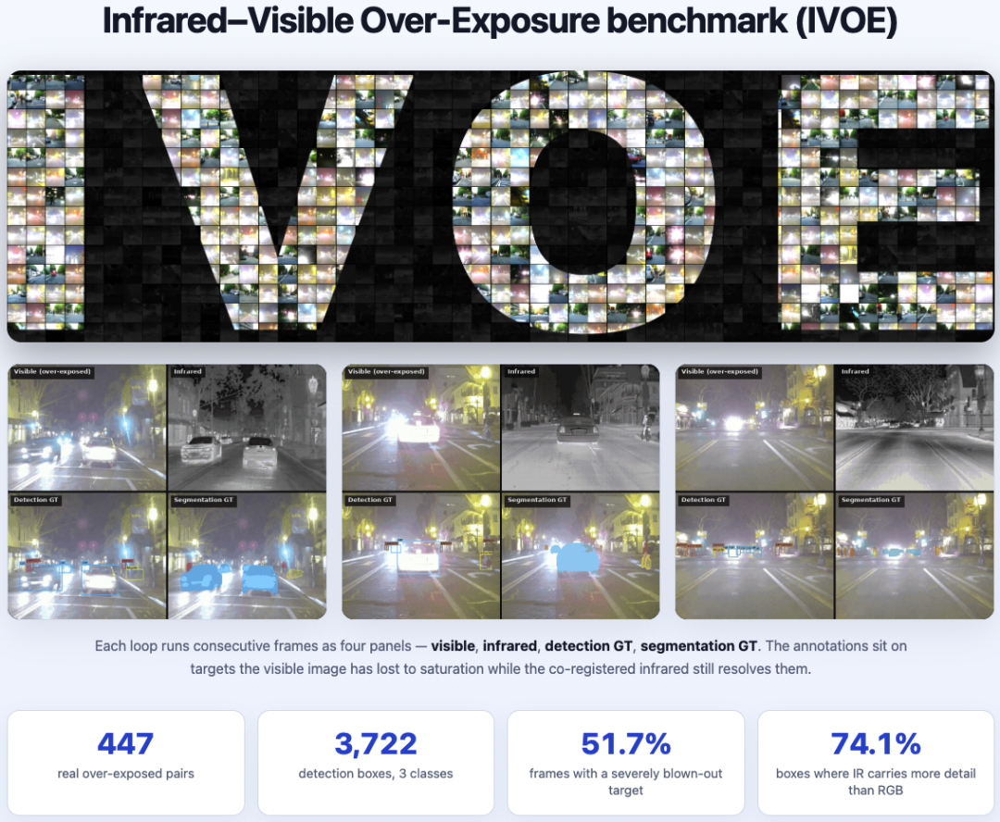

[在网页中查看](https://mmifusion.github.io/Datasets/#dataset=ivoe)

---

### Night-TIR数据集

**标签：** 退化恢复、增强与融合

**发表团队：** 昆明理工大学团队 @Pu Li、Huafeng Li、Yafei Zhang，联合合肥工业大学 Yu Liu、云南大学 Wen Wang，其中 Wen Wang 为通讯作者

**论文题目：** Breaking Degradation Coupling: A Structural Entropy–Guided Decoupled Framework and Benchmark for Infrared Enhancement

**发表：** CVPR Finding 2026（作者仓库标注）；另有 arXiv:2604.22886，2026，正式收录信息仍需核实

**下载链接：** https://github.com/Kust-lp/SEGD

Night-TIR 是面向夜间热红外增强与复合退化恢复的真实场景测试基准，包含 647 张由 DJI Matrice 4T 无人机采集的夜间热红外图像，分辨率为 640×512。场景涵盖道路、行人、车辆和建筑等；配套构造了单一及复合退化样本，用于红外增强与恢复研究。

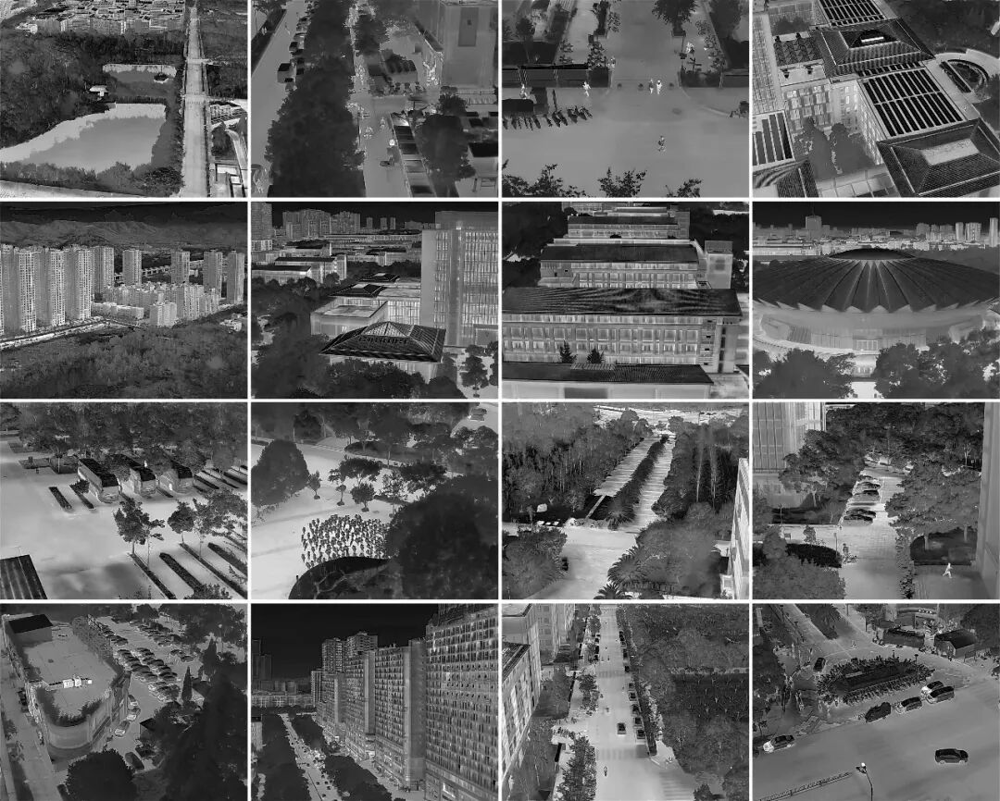

[在网页中查看](https://mmifusion.github.io/Datasets/#dataset=night-tir)

---

### HDRT数据集（红外引导HDR成像／RGB–热红外融合）

**标签：** 退化恢复、增强与融合

**发表团队：** 华威大学、华东理工大学、意大利国家研究委员会 ISTI 联合团队 @Jingchao Peng、Thomas Bashford-Rogers、Francesco Banterle、Haitao Zhao、Kurt Debattista

**论文题目：** HDRT: A large-scale dataset for infrared-guided HDR imaging

**发表：** Inf. Fusion 2025

**论文链接：** https://doi.org/10.1016/j.inffus.2025.103109

**下载链接：** https://huggingface.co/datasets/jingchao-peng/HDRTDataset

这篇论文构建配准的热红外、普通动态范围（SDR）与高动态范围（HDR）联合数据，并提出 HDRTNet，利用红外和单曝光可见光图像生成 HDR 结果。数据覆盖八座城市、三个季节，共 50,000 幅图像，包括 10,000 幅红外、30,000 幅不同曝光的 SDR 和 10,000 幅 HDR 图像，不能将总图像数误记为 50,000 对独立场景。它直接补充欠曝光、过曝光条件下的跨模态融合与细节恢复，是红外—可见光融合向 HDR 成像拓展的相关资源。

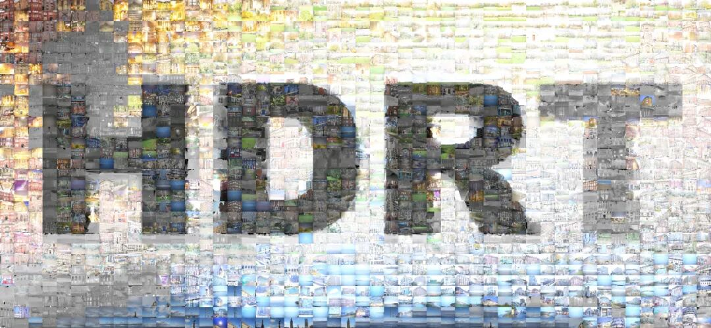

[在网页中查看](https://mmifusion.github.io/Datasets/#dataset=hdrt)

---

### DA-IVIF数据集（退化感知红外—可见光融合／文本辅助融合）

**标签：** 退化恢复、增强与融合

**发表团队：** SGDAFusion 联合研究团队 @Guanghui Yue、Zhirong Yao、Cheng Zhao、Weiqing Yan、Bin Jiang、Tianwei Zhou

**论文题目：** Semantic prior guided degradation-aware network for infrared-visible image fusion

**发表：** Information Fusion，139(A):104811，2027（卷期年份；DOI：10.1016/j.inffus.2026.104811）

**论文链接：** https://doi.org/10.1016/j.inffus.2026.104811

**下载链接：** https://github.com/yaozhirong1129/SGDAFusion

这篇论文提出语义先验引导的退化感知融合网络 SGDAFusion，并构建 DA-IVIF 数据集，包含 7,536 对配准的红外—可见光图像，覆盖八类常见退化，同时提供退化描述与融合目标描述文本。数据按成像设备区分域内与域外样本：域内 6,056 对，其中训练 4,844 对、测试 1,212 对；域外测试 1,480 对。该资源适合退化鲁棒融合、文本引导融合和跨设备泛化评估，属于值得补充的新近专用数据集。

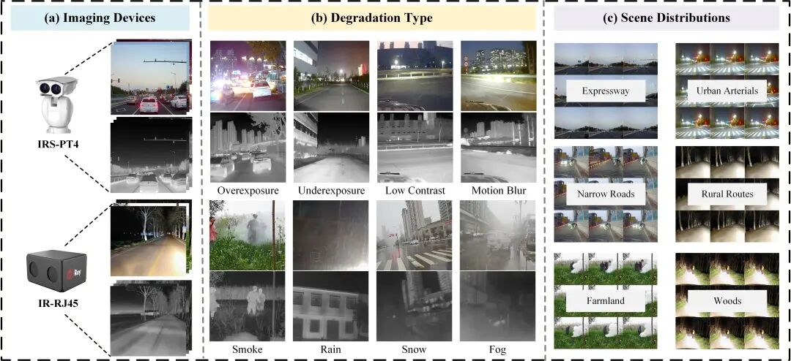

[在网页中查看](https://mmifusion.github.io/Datasets/#dataset=da-ivif)

---

### FOGIV数据集（去雾与红外—可见光联合融合／合成退化）

**标签：** 退化恢复、增强与融合 ｜ 合成退化

**发表团队：** 陆军工程大学指挥控制工程学院等联合团队 @Xianghe Bi、Yang Li、Wenyu Ji、Jiabao Wang、Ruizhi Fu、Zhuang Miao

**论文题目：** FIVFusion: Fog-free infrared and visible image fusion

**发表：** JKSUCIS 2025

**论文链接：** https://doi.org/10.1007/s44443-025-00309-7

**下载链接：** https://github.com/XiangheBi/FIVFusion

这篇论文将去雾与红外—可见光融合联合建模，基于 M3FD 图像通过大气散射模型构造 FOGIV，包含 1,540 组有雾可见光、清晰可见光与红外图像，划分为 1,500 组训练和 40 组测试，并提供轻雾、浓雾条件。该数据适合评价雾天融合及恢复能力；它是已有场景的合成退化版本，不应作为全新实采场景与 M3FD 简单合并计数。

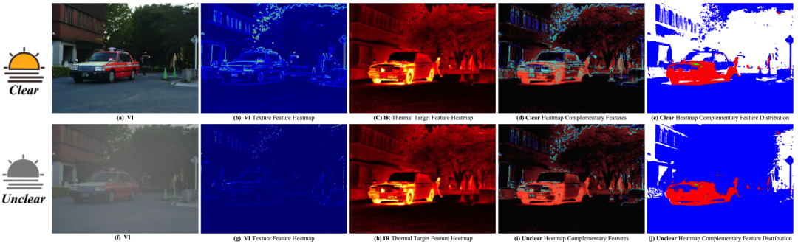

[在网页中查看](https://mmifusion.github.io/Datasets/#dataset=fogiv)

---

### IVMSD数据集（海事红外—可见光恢复、融合与分割／公开下载待确认）

**标签：** 退化恢复、增强与融合 ｜ 公开下载待确认

**发表团队：** 厦门大学、澳门大学、中山大学联合团队 @Weichao Cai、Weiliang Huang、Biao Xue、Chao Huang、Fei Yuan、Bob Zhang

**论文题目：** Unified Restoration-Perception Learning: Maritime Infrared-Visible Image Fusion and Segmentation

**发表：** arXiv 2026（预印本）

**论文链接：** https://arxiv.org/abs/2603.28414 论文页面（数据获取方式待确认）： https://arxiv.org/abs/2603.28414

这篇论文提出海事环境中的恢复—感知联合学习，并介绍 IVMSD，包含 2,313 对配准红外—可见光图像与船舶语义分割标注，涵盖正常、雾天、低照度及水面反射等情况。该数据直接关联恢复、图像融合和分割的联合评测，是海事专用融合方向的补充；它与已有 MIV 等资源名称相近但并非同一个数据集。

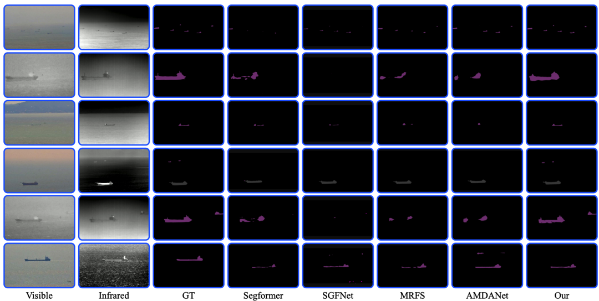

[在网页中查看](https://mmifusion.github.io/Datasets/#dataset=ivmsd)

---

### Visible-infrared Weather Degradation（可控融合论文配套）数据集（全天气恢复与可控红外—可见光融合／待发布）

**标签：** 退化恢复、增强与融合 ｜ 待发布

**发表团队：** 江南大学、萨里大学 CVSSP 联合团队 @Zeyang Zhang、Tianyang Xu、Hui Li、Chunyang Cheng、ChengCheng Song、Linze Li、Xiao-Jun Wu、Muhammad Awais、Josef Kittler

**论文题目：** Controllable Foundation Model for Visible and Infrared Image Fusion with All-in-One Bad Weather Removal

**发表：** TMM 2026

**论文链接：** https://doi.org/10.1109/TMM.2026.3710080

**下载链接：** https://openresearch.surrey.ac.uk/esploro/outputs/journalArticle/Controllable-Foundation-Model-for-Visible-and/991146051402346

这篇论文研究去除多种恶劣天气影响的可控可见光—红外融合，并提出包含退化类型和程度标签的天气退化数据。该资源对文本／语义控制、退化感知融合及多种天气统一恢复具有直接关联。由于数据规模、构造细节与发布包尚未得到完整核验，本条不补写未经确认的数量或开放声明。

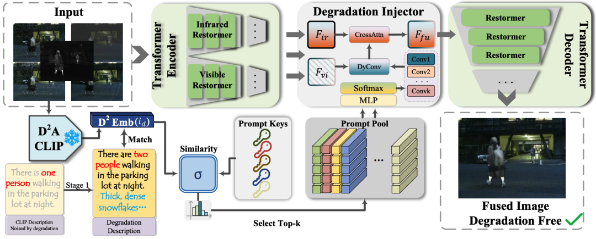

[在网页中查看](https://mmifusion.github.io/Datasets/#dataset=visible-infrared-weather-degradation)

---

### CoRFusion配套混合退化数据集（红外—可见光联合恢复融合／描述性名称／待发布）

**标签：** 退化恢复、增强与融合 ｜ 待发布  ｜  描述性名称

**发表团队：** CoRFusion 研究团队 @Ziyang Zhu、Hongtao Huo、Haozhe Cao、Xiaowen Liu、Yushan Cao、Dafu Zhu

**论文题目：** CoRFusion: Collaborative infrared-visible restoration-fusion via degradation-aware dynamic experts

**发表：** Infrared Phys. Technol. 2026

**论文链接：** https://doi.org/10.1016/j.infrared.2026.106563

**下载链接：** https://github.com/ziyang-Zhu/CoRFusion 作者仓库目前说明代码、权重和多场景退化数据将后续发布；尚不能当作已公开可下载的数据集使用。

这篇论文研究通过退化感知动态专家进行红外—可见光协同恢复与融合，介绍面向混合退化的数据资源，涉及雾、过曝光、低照度、噪声及散焦等情况。它直接补充复杂退化条件下的融合研究，但现阶段应归入论文已介绍、数据待发布的资源；本条使用描述性名称，不虚构独立数据集简称、样本数或全新实采来源。

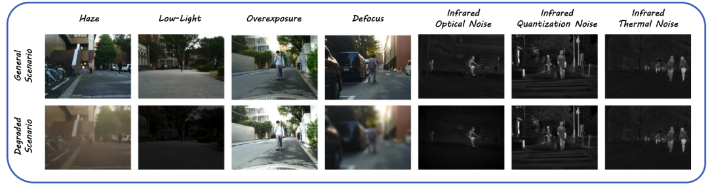

[在网页中查看](https://mmifusion.github.io/Datasets/#dataset=corfusion)

---

### EMS数据集

**标签：** 语言引导、质量评价与融合基准

**发表团队：** 武汉大学-JiaYi Ma团队： Xunpeng Yi; Han Xu; Hao Zhang; Linfeng Tang; Jiayi Ma

**论文题目：** Text-IF: Leveraging Semantic Text Guidance for Degradation-Aware and Interactive Image Fusion

**发表：** CVPR 2024

**下载链接：** https://github.com/XunpengYi/Text-IF；EMS数据集：EMS Dataset: Enhanced Multi-Spectral Various Scenarios for Degradation-Aware Image Fusion

EMS（Enhanced Multi-Spectral Various Scenarios）是一个专为退化感知图像融合设计的大规模多模态基准数据集，由武汉大学研究团队提出。该数据集整合并扩展了 MFNet、RoadScene、FLIR_aligned 和 LLVIP 四个已有多光谱图像数据集，涵盖多种真实交通与监控场景。EMS 数据集包含两个子集：EMS-Lite 提供了轻量级的多模态图像对，模拟了如低光、过曝、红外低对比度和噪声等常见退化；EMS-Full 则更具挑战性，加入了雨、雾、模糊、条纹噪声等多种复合退化因素。总计包含数万张红外-可见光图像对，并附带对应的高质量图像和自然语言提示信息，用于支持多模态感知与退化条件下的图像融合研究。

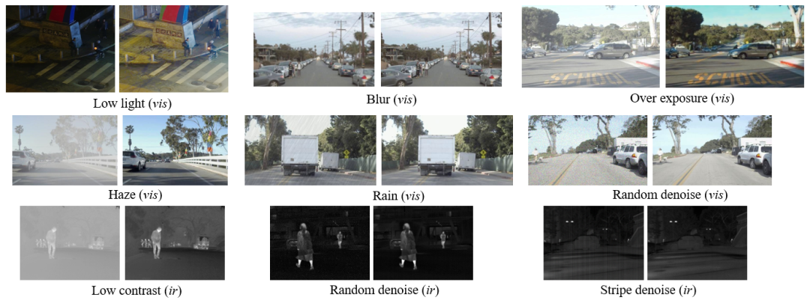

[在网页中查看](https://mmifusion.github.io/Datasets/#dataset=ems)

---

### IVT数据集

**标签：** 语言引导、质量评价与融合基准

**发表团队：** 江南大学-吴小俊团队@Chunyang Cheng、Tianyang Xu、Xiao-Jun Wu、Hui Li、Xi Li、Zhangyong Tang、Josef Kittler

**论文题目：** TextFusion: Unveiling the power of textual semantics for controllable image fusion

**发表：** Inf. Fusion 2025

**下载链接：** https://github.com/AWCXV/TextFusion

文中提出一个名为 IVT 数据集的全新基准。该数据集由多源 RGBT 数据精心整理而成，包含 11,450 对严格对齐的红外与可见光图像对，并配有 人工标注的文本描述 。在数据构建过程中，训练集由研究团队提供结构化描述，强调目标和空间语境；而测试集则由 50 位独立志愿者（包含 25 名计算机视觉相关背景的专业人员和 25 名跨越 10 岁到 70 岁的非专业人员）完成标注，以保证多样性和客观性 。这些文本描述以客观中立为主，平均不超过三句话，并通过不同句子的组合形成多种长度的描述，从而丰富了训练与测试样本的语义表达。最终数据集广泛涵盖了行人、车辆、街景等常见场景目标，成为首个面向 可控图像融合 的文本注释 RGBT 数据集。

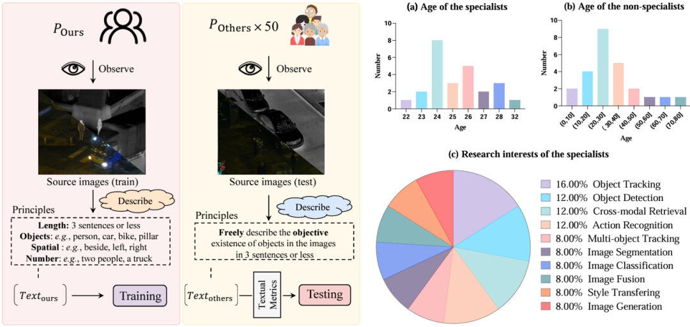

[在网页中查看](https://mmifusion.github.io/Datasets/#dataset=ivt)

---

### VLF数据集（视觉—语言图像融合）

**标签：** 语言引导、质量评价与融合基准

**发表团队：** 西安交通大学、苏黎世联邦理工学院等联合团队 @Zixiang Zhao、Lilun Deng、Haowen Bai、Yukun Cui、Zhipeng Zhang、Yulun Zhang、Haotong Qin、Dongdong Chen、Jiangshe Zhang、Peng Wang、Luc Van Gool

**论文题目：** Image Fusion via Vision-Language Model

**发表：** ICML 2024

**论文链接：** https://proceedings.mlr.press/v235/zhao24d.html

**下载链接：** https://github.com/Zhaozixiang1228/IF-FILM

这篇论文提出 FILM，并构建 VLF 视觉—语言融合数据资源，为八个既有数据集、四类图像融合任务补充由 ChatGPT 生成的段落级描述。红外—可见光部分涉及 MSRS、M3FD 和 RoadScene 等数据，可用于文本语义引导的图像融合。VLF 是已有图像数据上的语言标注扩展，不能视为完全独立采集的新场景数据；使用时应同时注明原始图像来源。

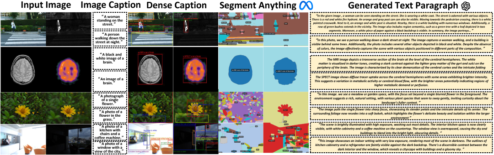

[在网页中查看](https://mmifusion.github.io/Datasets/#dataset=vlf)

---

### EVAFusion数据集

**标签：** 语言引导、质量评价与融合基准

**发表团队：** 大连理工大学、浙江大学、大连海事大学联合团队 @Jinyuan Liu、Xingyuan Li、Qingyun Mei、Haoyuan Xu、Zhiying Jiang、Long Ma、Risheng Liu、Xin Fan，其中 Xin Fan 为通讯作者。

**论文题目：** Bridging Human Evaluation to Infrared and Visible Image Fusion

**发表：** CVPR 2026

**下载链接：** https://github.com/ALKA-Wind/EVAFusion

EVAFusion 面向红外—可见光融合的感知质量评价。原文介绍从 8 个公开数据集中筛选 850 对图像，并使用 11 种融合方法生成 9,350 张结果；标注涵盖热信息保留、纹理、伪影和清晰度等维度，采用专家种子标注、GPT-4o 扩展及人工复核。

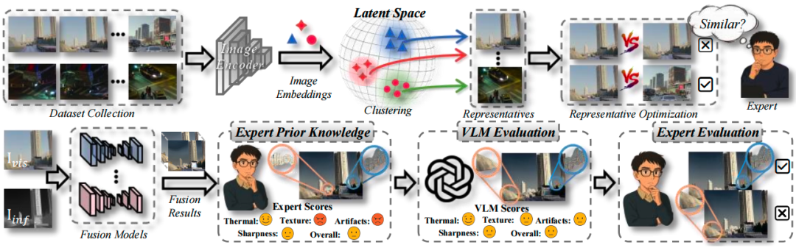

[在网页中查看](https://mmifusion.github.io/Datasets/#dataset=evafusion)

---

### VISTA数据集（融合图像质量评价）

**标签：** 语言引导、质量评价与融合基准

**发表团队：** 西安电子科技大学等联合团队 @Zhihao Chang、Shuyuan Yang、Zhixi Feng、Quanwei Gao、Shengzhe Wang、Yuyong Cui

**论文题目：** Semantic-Relation Transformer for Visible and Infrared Fused Image Quality Assessment

**发表：** Inf. Fusion 2023

**论文链接：** https://doi.org/10.1016/j.inffus.2023.02.021

**下载链接：** https://github.com/ChangeZH/VISTA-Dataset（当前主要提供演示，完整数据待核实）

这篇论文构建红外与可见光融合图像主观质量评价数据库 VISTA，并提出 Semantic-Relation Transformer 评价方法。其用途是学习和评估融合结果的感知质量，而不是仅提供源图像进行常规融合训练，可与 EVAFusion 等质量评价资源一起介绍。当前作者仓库主要提供演示样例，仍注明详细数据后续发布，完整数据的获取情况需进一步确认。

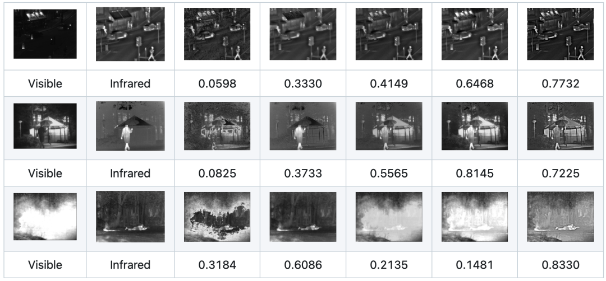

[在网页中查看](https://mmifusion.github.io/Datasets/#dataset=vista)

---

### IVFIQA数据集（红外—可见光融合主观质量评价）

**标签：** 语言引导、质量评价与融合基准

**发表团队：** 湖南大学、宁波大学联合团队 @Xiangchao Meng、Chaoqi Chen、Qiang Liu、Feng Shao

**论文题目：** Multi‐domain pseudo‐reference quality evaluation for infrared and visible image fusion

**发表：** IET Image Process. 2024

**论文链接：** https://doi.org/10.1049/ipr2.13236

**下载链接：** https://ietresearch.onlinelibrary.wiley.com/doi/10.1049/ipr2.13236

这篇论文构建 IVFIQA 融合图像质量评价数据集，包含 60 对红外—可见光源图像及 540 幅具有不同失真类型和程度的融合图像，并收集 30 名参与者给出的 16,200 个主观评分。论文同时提出多域伪参考评价模型 MPIQAM。该数据适合研究客观融合指标与人类感知的一致性，属于质量评价数据，不能直接等同于用于训练融合网络的大规模独立采集图像对。

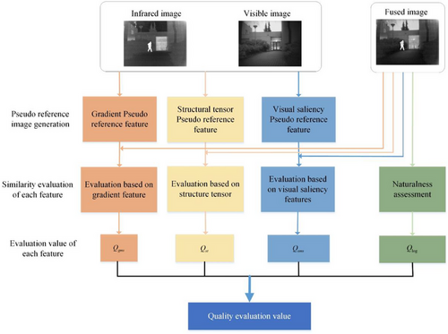

[在网页中查看](https://mmifusion.github.io/Datasets/#dataset=ivfiqa)

---

### LPIFM配对偏好数据集（红外—可见光融合感知评价与偏好标注）

**标签：** 语言引导、质量评价与融合基准

**发表团队：** 成都理工大学等联合团队 @Haoran Liu、Mingzhe Liu、Peng Li、Guibin Zan

**论文题目：** Ranking Infrared-Visible Fusion the Way Humans Do: A Learned Pairwise Preference Measure

**发表：** arXiv 2026（预印本）

**论文链接：** https://arxiv.org/abs/2608.01301

**下载链接：** https://zenodo.org/records/21823281

这篇论文提出 Learned Perceptual Image Fusion Measure（LPIFM），以同一组红外、可见光源图像及两幅候选融合结果为输入，学习“候选A更好、候选B更好或相当”的人类偏好判断。配套资源提供基于 VIFB 的成对偏好标签及 EVAFusion 微调相关划分，适合融合结果排序、感知质量评价和偏好学习。它是既有图像上的新增评价标注资源，不是独立采集的新场景数据集。

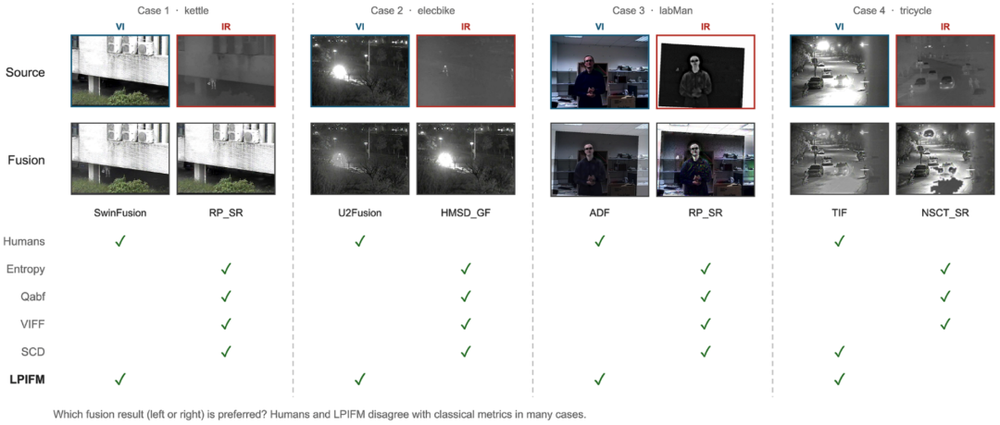

[在网页中查看](https://mmifusion.github.io/Datasets/#dataset=lpifm)

---

### IVSI数据集（红外—可见光融合／人工筛选监督图像）

**标签：** 语言引导、质量评价与融合基准

**发表团队：** 中国海洋大学郑海永团队 @Guihui Li、Zhensheng Shi、Zhaorui Gu、Bing Zheng、Haiyong Zheng

**论文题目：** Reference-then-supervision framework for infrared and visible image fusion

**发表：** PR 2025

**论文链接：** https://doi.org/10.1016/j.patcog.2024.110996

**下载链接：** https://github.com/zhenglab/ReferenceSupervisionIVIF

这篇论文提出先构建参考、再进行监督的红外—可见光融合框架，并发布含人工挑选监督图像的 IVSI 数据集。它可用于研究融合监督信号、主观质量偏好及有参考训练。这里的监督图像来自融合结果的生成与筛选，不能等同于唯一、物理真实的融合真值。IVSI 与本文已有的 IVSD 多光谱拼接数据集不同，应分别收录。

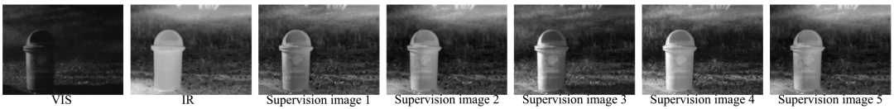

[在网页中查看](https://mmifusion.github.io/Datasets/#dataset=ivsi)

---

### MRLL数据集（真实低照度红外—可见光融合）

**标签：** 图像融合：低照度、特殊场景与空中视角

**发表团队：** 东南大学、武汉大学联合团队 @Jiajun Chen、Han Xu、Guangcan Liu、Jiayi Ma

**论文题目：** Breaking Low-Light Fusion Barrier: Unsupervised Darkness and Noise-Aware Visible and Infrared Image Fusion Network

**发表：** TIP 2026

**论文链接：** https://doi.org/10.1109/TIP.2026.3713440

**下载链接：** https://github.com/ChenDoubleJ/BLFusion-MRLL

这篇论文提出 BLFusion，并发布 Multi-modal Real-world Low-Light（MRLL）数据集，包含 500 对配准的红外—可见光图像，分辨率为 960×720。数据采用同步双光谱设备采集，覆盖室内、室外真实夜间场景及不同照度和噪声模式，适合检验融合模型在亮度不足与真实噪声同时存在时的表现，是现有常规道路融合数据之外的低照度补充。

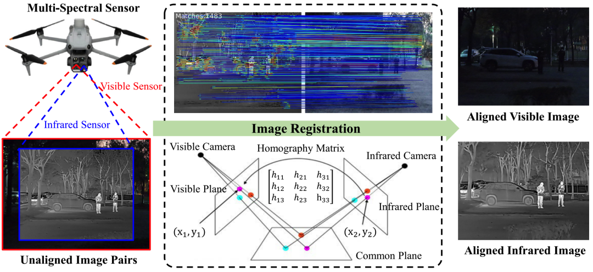

[在网页中查看](https://mmifusion.github.io/Datasets/#dataset=mrll)

---

### LLHO数据集（原创采集／低照度红外—可见光图像融合）

**标签：** 图像融合：低照度、特殊场景与空中视角

**发表团队：** UFIVL／LLHO 研究团队 @Shuai Yang、Yuan Gao、Shiwei Ma

**论文题目：** An unsupervised fusion method for infrared and visible image under low-light condition based on Generative Adversarial Networks

**发表：** Signal Process. Image Commun. 2025

**论文链接：** https://doi.org/10.1016/j.image.2025.117324

**下载链接：** https://github.com/alex551781/LLHO

这篇论文提出低照度红外—可见光无监督融合方法 UFIVL，并自主采集 LLHO，包含低照度条件下的行人、车辆及其他物体。论文说明采用 FLIR T600 工业相机，在低于 200 lux 的照度下进行实景拍摄，并开展图像配准；实验选取其中 280 对夜间图像用于训练。其来源是作者独立采集，符合原创红外—可见光数据的补充条件。这里的 280 对是训练使用量，不作为整个数据集的总量。

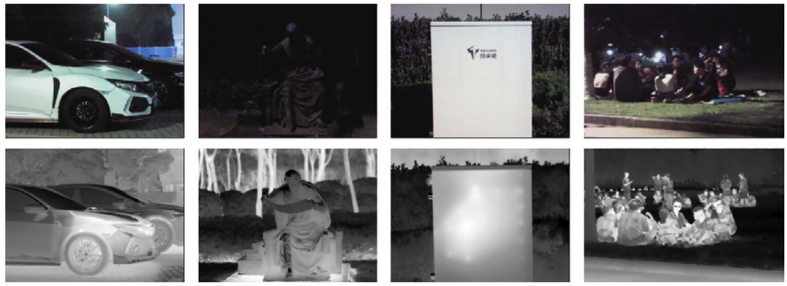

[在网页中查看](https://mmifusion.github.io/Datasets/#dataset=llho)

---

### NVFusion配套微光夜视数据集（红外—微光夜视融合／描述性名称／公开下载待确认）

**标签：** 图像融合：低照度、特殊场景与空中视角 ｜ 公开下载待确认  ｜  描述性名称

**发表团队：** 西安电子科技大学人工智能学院团队 @Chenchen Li、Fu Li、Yi Niu、Zhifu Zhao

**论文题目：** NVFusion: Lightweight infrared and low-light night vision image fusion in dark environments

**发表：** Neurocomputing 2026

**论文链接：** https://doi.org/10.1016/j.neucom.2025.132449

**下载链接：** https://www.sciencedirect.com/science/article/abs/pii/S0925231225031212

这篇论文面向极暗环境中的红外与微光夜视图像融合，使用自研同步双目设备采集超过 8,000 对图像，覆盖 11 个微光场景。它可补充普通低照度 RGB 数据之外的夜视成像条件，但微光夜视图像的成像链与普通 RGB 摄像机不同，不能直接归为常规彩色 RGB—热红外数据。数据采集与实验由论文报告，公开获取状态仍待确认。

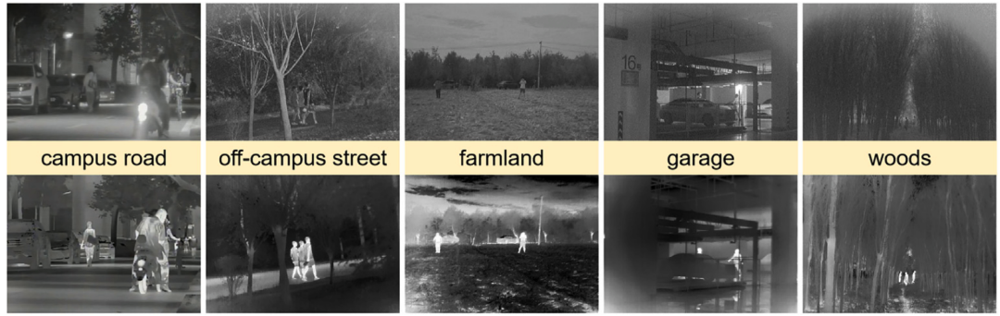

[在网页中查看](https://mmifusion.github.io/Datasets/#dataset=nvfusion)

---

### CLTE配套养殖场数据集（农业场景红外—可见光融合）

**标签：** 图像融合：低照度、特殊场景与空中视角

**发表团队：** CLTE联合研究团队 @Ge Wang、Yong Ma、Jun Huang、Kangle Wu、Linfeng Tang、Zhao Cai、Fan Fan

**论文题目：** CLTE: Infrared and visible image fusion through cross-domain learning and texture-contrast enhancement

**发表：** Infrared Phys. Technol. 2026

**论文链接：** https://www.sciencedirect.com/science/article/pii/S1350449525005237

**下载链接：** https://github.com/HUBUwg96/CLTE

这篇论文针对集约化养殖环境提出跨域学习与纹理对比度增强的红外—可见光融合方法，并提供 648 对真实猪场图像，补充常见道路、行人场景之外的农业数据。该数据适合低光照动物监测和农业场景融合研究。CLTE 是论文方法名称，因此这里使用“CLTE配套养殖场数据集”作为描述性条目名，下载入口见作者仓库。

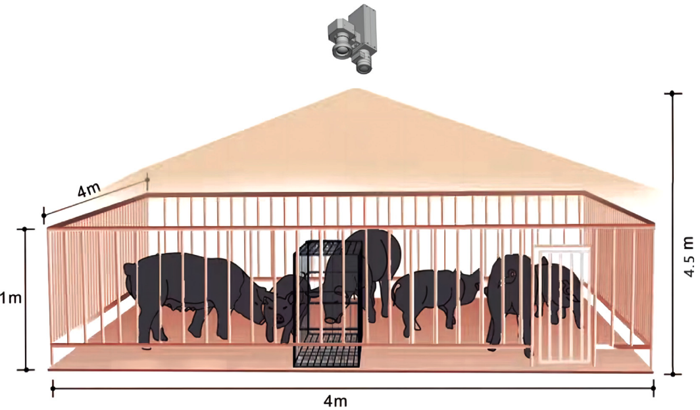

[在网页中查看](https://mmifusion.github.io/Datasets/#dataset=clte)

---

### MIV数据集（海上红外—可见光融合）

**标签：** 图像融合：低照度、特殊场景与空中视角

**发表团队：** 广东工业大学等联合团队 @Xuhui Zhang、Yunpeng Yin、Zhuowei Wang、Heng Wu、Lianglun Cheng、Aimin Yang、Genping Zhao

**论文题目：** Robust Infrared–Visible Fusion Imaging with Decoupled Semantic Segmentation Network

**发表：** Sensors 2025

**论文链接：** https://doi.org/10.3390/s25092646

**下载链接：** https://github.com/xhzhang0377/MIV-Dataset（作者仓库：部分数据已公开）

这篇论文提出解耦语义分割驱动的红外—可见光图像融合网络，并提供海上配准红外与可见光图像资源 MIV，用于扩展海事场景下的融合研究。其场景与常用道路数据不同，可用于考察海面背景和船舶目标的信息保留。作者仓库目前明确说明仅公开了部分图像，因此应标记为“部分公开”，不把论文描述的完整数据规模等同于实际可下载规模。

[在网页中查看](https://mmifusion.github.io/Datasets/#dataset=miv)

---

### UAVScene（MCDFuse配套）数据集（无人机红外—可见光融合）

**标签：** 图像融合：低照度、特殊场景与空中视角

**发表团队：** 海军工程大学团队 @Yu Zhang、Hao Cha、HanRui Zhang、XiongHui Li、Zhuo Chen、JiaMing Bai、TingTing Fu、Yong Cheng Du、Xian Zhang

**论文题目：** MCDFus: visible and infrared image fusion via Mamba-CNN for enhanced UAV perception

**发表：** Multimed. Syst. 2026

**论文链接：** https://doi.org/10.1007/s00530-025-02080-1

**下载链接：** https://github.com/MCDFuse/UAVScene目前公开 300 对示例图像；完整数据需向通信作者申请。仓库下载段落亦使用 UAVSense 名称，此处按仓库名记为 UAVScene。

这篇论文提出面向无人机感知的 MCDFuse，并构建无人机视角的可见光—红外融合数据。作者仓库提供配准图像及 YOLO 格式标注，包含可见光、红外和融合图像对应的标注目录，可用于评估图像融合质量及融合后目标检测表现。该资源补充俯视场景、复杂背景与无人机成像条件，使用时需区分公开示例与完整数据，不能将示例规模视为完整规模。

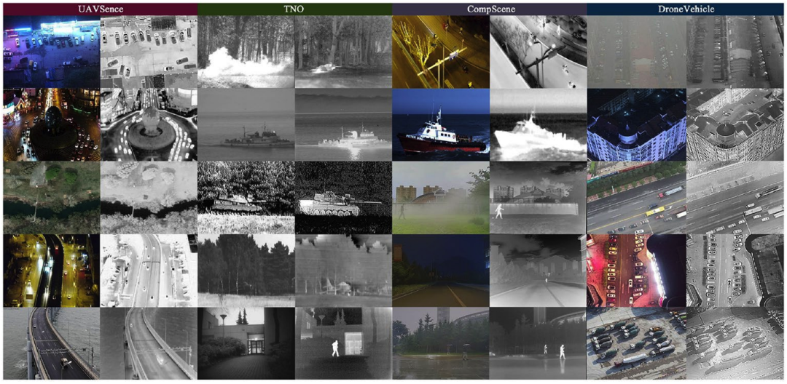

[在网页中查看](https://mmifusion.github.io/Datasets/#dataset=uavscene)

---

### DGFusion配套航拍数据集（无人机可见光—热红外融合）

**标签：** 图像融合：低照度、特殊场景与空中视角

**发表团队：** 同济大学、香港大学联合团队 @Changhong Fu、Xiang Huang、Zijie Zhang、Haobo Zuo、Yongkang Cao、Shenghao Ren

**论文题目：** DGFusion: Discrepancy-Guided Network for Aerial Visible-Thermal Image Fusion

**发表：** ICARM 2025

**论文链接：** https://doi.org/10.1109/ICARM65671.2025.11293736

**下载链接：** https://github.com/vision4robotics/DGFusion

这篇论文提出差异引导的航拍可见光—热红外融合方法，并构建 8,700 对配准图像的无人机视角基准，其中训练集 6,393 对、测试集 2,307 对。数据覆盖多种具有挑战性的航拍场景，可用于研究跨模态差异建模和无人机场景融合。DGFusion 是方法名称，这里用“DGFusion配套航拍数据集”作描述性条目名；它与其他同名 DGFusion 方法应按论文全名区分。

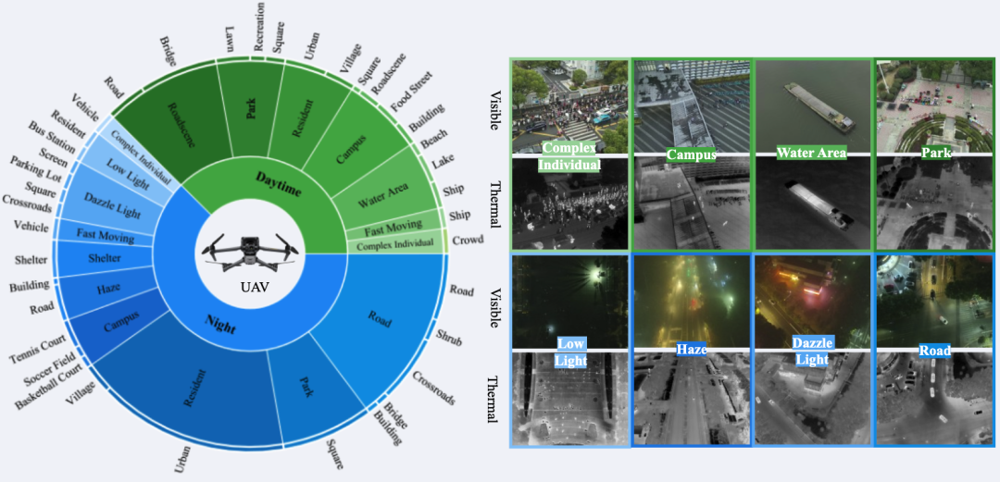

[在网页中查看](https://mmifusion.github.io/Datasets/#dataset=dgfusion)

---

### UAV-MSR数据集（无人机野外搜救红外—可见光图像融合）

**标签：** 图像融合：低照度、特殊场景与空中视角

**发表团队：** 空军军医大学军事生物医学工程学系、陕西省生物电磁检测与智能感知重点实验室团队 @Yu Jing、Yili Yan、Zhao Li、Fugui Qi、Tao Lei、Jianqi Wang、Guohua Lu

**论文题目：** DCAFuse: A Differential Cross-Attention Transformer Network for Infrared and Visible Image Fusion in UAV-Based Wilderness Search and Rescue

**发表：** Drones 2026

**论文链接：** https://www.mdpi.com/2504-446x/10/6/449

**下载链接：** https://github.com/jingyu-maker/UAV-MSR-dataset

这篇论文为无人机野外伤员搜救构建 UAV-MSR，包含 3,889 对时空同步、完成配准的红外—可见光图像及 7,573 个目标标注。数据采用 DJI Matrice 30T 采集，覆盖不同飞行高度、天气和植被遮挡条件，并用 DCAFuse 进行融合及下游检测评测。它直接针对像素级图像融合，补充地面道路数据较少覆盖的无人机搜救场景。

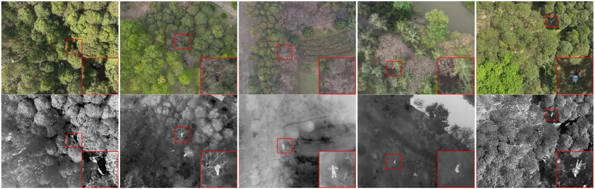

[在网页中查看](https://mmifusion.github.io/Datasets/#dataset=uav-msr)

---

### MSIV数据集（红外—可见光融合）

**标签：** 图像融合：低照度、特殊场景与空中视角

**发表团队：** DSFuse联合研究团队 @Zhijia Yang、Kun Gao、Yanzheng Zhang、Xiaodian Zhang、Zibo Hu、Junwei Wang、Jingyi Wang、Wei Li

**论文题目：** DSFuse: A Dual-Diffusion Structure for Feature Fidelity Infrared and Visible Image Fusion

**发表：** TNNLS 2025

**论文链接：** https://doi.org/10.1109/TNNLS.2025.3584834

**下载链接：** https://github.com/Yzhijia/Multi-Scenary-Infrared-and-Visible-images-dataset

这篇论文提出 DSFuse，并发布用于红外与可见光融合训练和评估的 MSIV 多场景数据集。作者仓库介绍其包含约 7,000 对配准图像，覆盖城市街道、自然景观、湖泊和建筑等场景，以及白天、夜间和雨天等条件。数据提供红外与可见光图像，并另设检测标注下载入口，可用于常规融合、跨场景泛化及融合后目标检测研究。

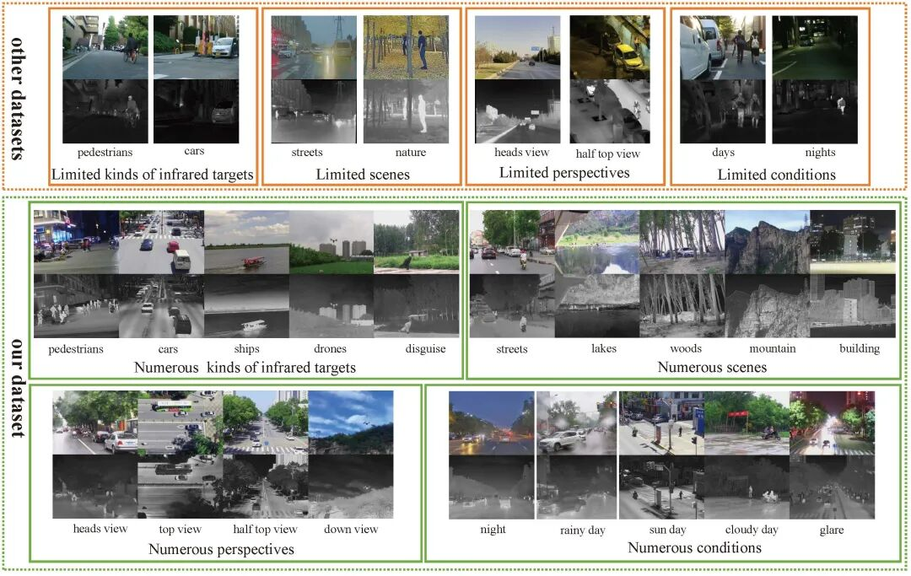

[在网页中查看](https://mmifusion.github.io/Datasets/#dataset=msiv)

---

### Campus Dual-Spectral（校园双光谱）数据集（原创采集／红外—可见光融合评测／描述性名称）

**标签：** 图像融合：低照度、特殊场景与空中视角 ｜ 描述性名称

**发表团队：** 校园双光谱融合评测研究团队 @Beining Xu、Junxian Li

**论文题目：** Design and Evaluation of Deep Learning-Based Dual-Spectrum Image Fusion Methods

**发表：** arXiv 2025（预印本）

**论文链接：** https://arxiv.org/abs/2506.07779 论文页面（数据获取方式待确认）： https://arxiv.org/abs/2506.07779

这篇论文独立采集校园环境中的双光谱视频，经时间同步、标定和空间对齐构建 1,369 对红外—可见光图像，分辨率为 640×512。数据包括白天校园道路 159 对、夜间校园道路 80 对、烟雾遮挡 550 对，以及桥下光照变化 580 对；其中道路场景提供目标检测标注。论文结合融合质量、速度与下游检测开展评测，因此该数据与图像融合直接相关，而非对已有道路数据的重新划分。

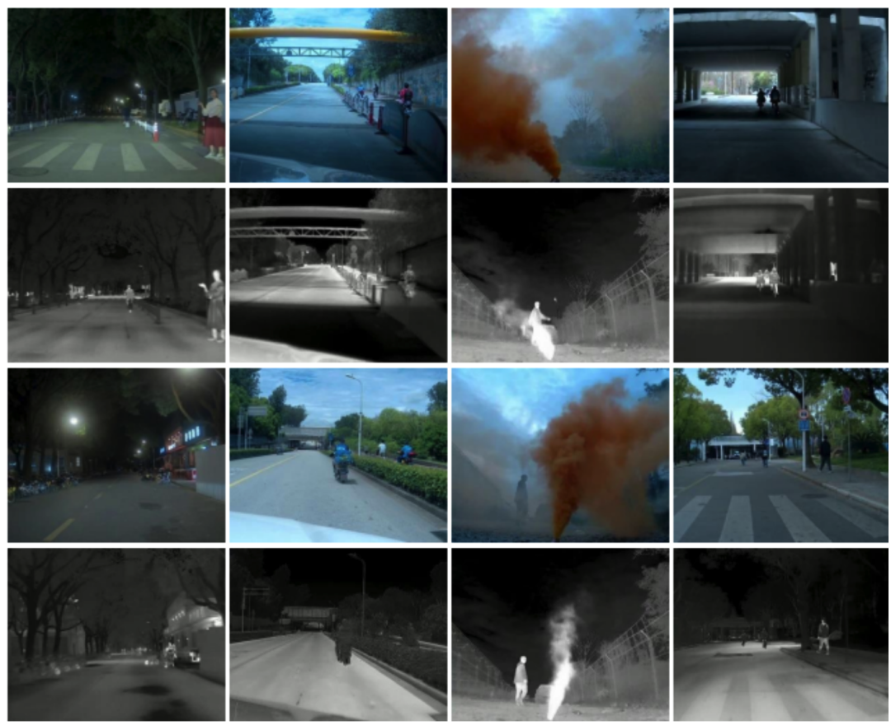

[在网页中查看](https://mmifusion.github.io/Datasets/#dataset=campus-dual-spectral)

---

### MFNet数据集

**标签：** 语义分割与指代表达分割

**发表团队：** 东京大学-Harada/Ushiku团队：Qishen Ha、Kohei Watanabe、Takumi Karasawa、Yoshitaka Ushiku、Tatsuya Harada

**论文题目：** MFNet: Towards real-time semantic segmentation for autonomous vehicles with multi-spectral scenes

**发表：** IROS 2017

**下载链接：** https://www.mi.t.u-tokyo.ac.jp/static/projects/mil_multispectral/

作者构建并公开了一个全新的RGB-热红外（RGB-Thermal）语义分割数据集，以支持自动驾驶场景下多光谱图像的语义理解研究。该数据集共包含 1569 张城市道路场景图像，其中 820 张为白天拍摄，749 张为夜间拍摄，每张图像均具备像素级别的语义标注，涵盖了 8 类常见障碍物（如汽车、行人、自行车、弯道、停车标志、护栏、交通锥和减速带）。图像采集使用的是 InfRec R500 设备，分别获取了可见光（RGB）和热红外（IR）图像，均具有 480×640 的空间分辨率。为保证视场一致性，作者对RGB图像进行裁剪以与红外图像对齐。

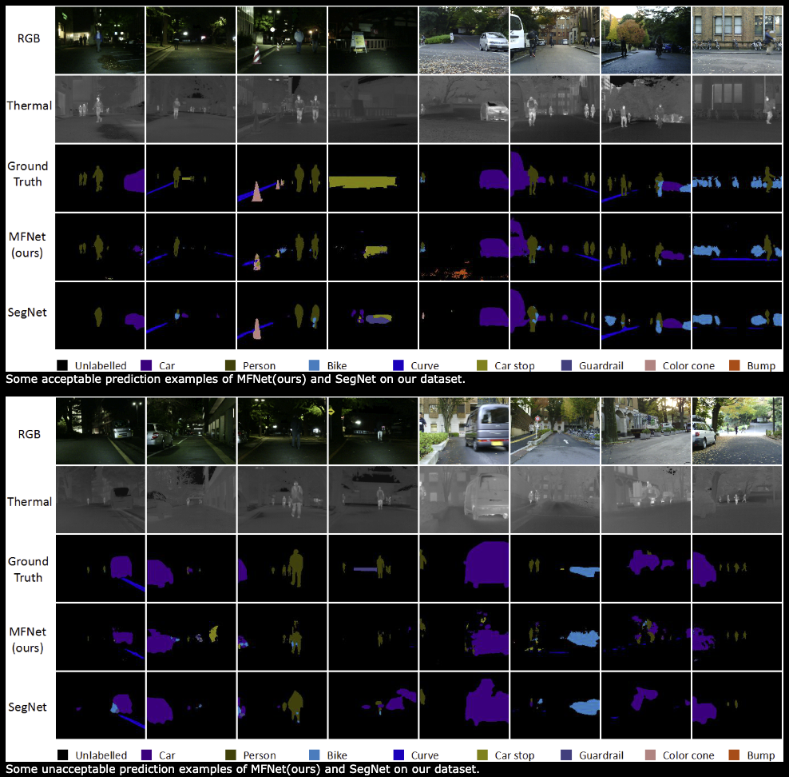

[在网页中查看](https://mmifusion.github.io/Datasets/#dataset=mfnet)

---

### PST900数据集

**标签：** 语义分割与指代表达分割

**发表团队：** GRASP Laboratory（University of Pennsylvania，宾夕法尼亚大学） @Shreyas S. Shivakumar、Neil Rodrigues、Alex Zhou、Ian D. Miller、Vijay Kumar、Camillo J. Taylor

**论文题目：** PST900: RGB-Thermal Calibration, Dataset and Segmentation Network

**发表：** ICRA 2020

**下载链接：** https://github.com/ShreyasSkandanS/pst900_thermal_rgb

PST900（Penn Subterranean Thermal 900）是由宾夕法尼亚大学 GRASP 实验室提出的一个用于RGB-热红外图像语义分割的标注数据集，旨在提升机器人在地下复杂环境中的感知能力。该数据集包含 894 对已校准对齐的 RGB 和 LWIR（长波红外）图像对，并提供了逐像素的人工标注，涵盖 灭火器、背包、电钻和受困者等四类关键目标。此外，数据还包括 3416 张额外标注的 RGB 图像，用于增强模型的训练泛化能力。图像采集于如矿井、隧道等低光甚至无光照环境，使用 FLIR Boson 热像仪和 Stereolabs ZED Mini 立体相机完成。该数据集特别强调了被动式校准方法的便捷性，以及 RGB 与热图融合在分割精度上的提升。

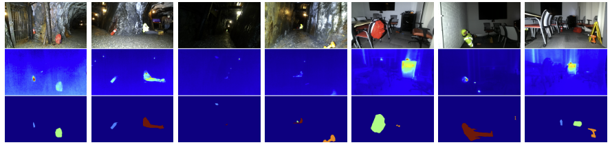

[在网页中查看](https://mmifusion.github.io/Datasets/#dataset=pst900)

---

### AVMS数据集 （语义分割标签·目标检测标签）

**标签：** 语义分割与指代表达分割

**发表团队：** 佛山大学-李小松团队：Yuchan Jie、Yushen Xu、Xiaosong Li、Fuqiang Zhou、Jianming Lv、Huafeng Li

**论文题目：** FS-Diff: Semantic guidance and clarity-aware simultaneous multimodal image fusion and super-resolution

**发表：** Inf. Fusion 2025

**下载链接：** https://github.com/XylonXu01/FS-Diff

AVMS（Aerial View Multi-Scene）数据集是FS-Diff论文中自建的多模态图像融合与超分辨任务专用数据集，旨在解决现有数据集在远距离拍摄、多样场景与模态清晰度不一致等方面的不足。该数据集共包含600对配准的可见光（VI）和红外（IR）图像，涵盖白天、夜晚、黄昏及复杂天气等多种光照条件，并涉及住宅区、道路、校园、公园、街道、体育场、停车场、农田等七类以上典型场景。此外，AVMS提供了共计8991个目标的精细标注（如车辆、人、帐篷、船只等），可广泛用于图像融合、超分辨、目标检测与语义分割等任务。该数据集特别适用于无人机航拍视角下的多模态图像处理研究，为复杂环境下的实际应用提供了重要支撑。

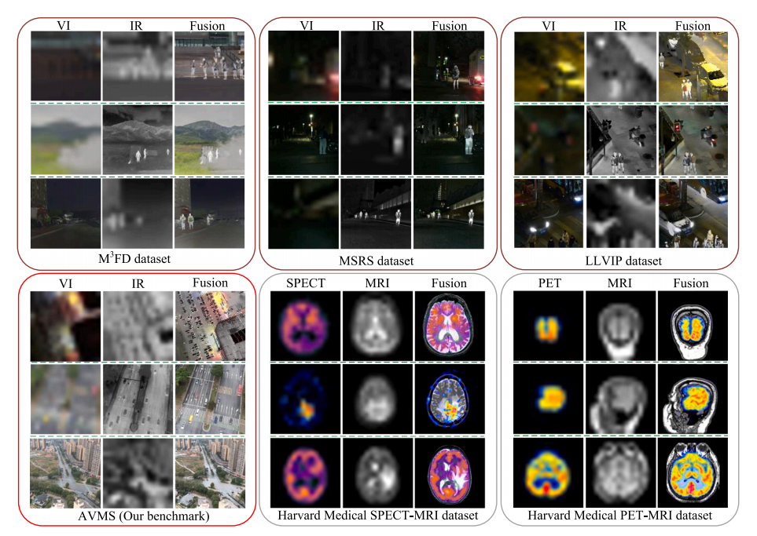

[在网页中查看](https://mmifusion.github.io/Datasets/#dataset=avms)

---

### MM-RIS数据集

**标签：** 语义分割与指代表达分割 【带有文本指示的分割标签】

**发表团队：** 清华大学、中央财经大学@Siju Ma、Changsiyu Gong、Xiaofeng Fan、Yong Ma、Chengjie Jiang

**论文题目：** RIS-FUSION: Rethinking Text-Driven Infrared and Visible Image Fusion from the Perspective of Referring Image Segmentation

**发表：** ICASSP 2026

**下载链接：** https://github.com/SijuMa2003/RIS-FUSION

MM-RIS 基于 MSRS 与 M3FD 构建，面向文本指引的多模态指代表达分割。原文介绍其包含约 12.5k 个训练样本和 3.5k 个测试样本，每个样本包含可见光、红外与融合图像、自然语言表达及对应目标掩码。

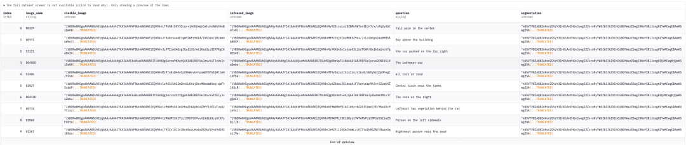

[在网页中查看](https://mmifusion.github.io/Datasets/#dataset=mm-ris)

---

### RGB-T Glass Segmentation数据集（玻璃场景RGB-T分割）

**标签：** 语义分割与指代表达分割

**发表团队：** 加拿大阿尔伯塔大学研究团队 @Dong Huo、Jian Wang、Yiming Qian、Yee-Hong Yang

**论文题目：** Glass Segmentation With RGB-Thermal Image Pairs

**发表：** TIP 2023

**论文链接：** https://doi.org/10.1109/TIP.2023.3256762

**下载链接：** https://github.com/Dong-Huo/RGB-T-Glass-Segmentation

这篇论文利用玻璃对可见光和热辐射不同的透射特性开展玻璃分割，并构建 5,551 对 RGB—热红外图像及对应分割标注。该资源补充普通道路数据较少涉及的透明材料场景，适合研究特殊材料下的跨模态差异和融合后任务表现。它属于任务型 RGB-T 扩展数据，融合时应考虑两种模态可能呈现不同物理表面的情况，不能简单将这种差异视为噪声。

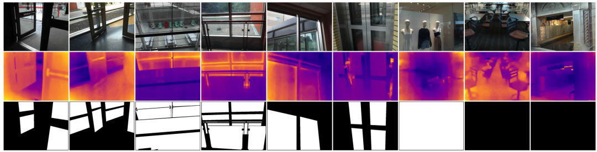

[在网页中查看](https://mmifusion.github.io/Datasets/#dataset=rgb-t-glass-segmentation)

---

### HDO数据集

**标签：** 视频融合与视频资源

**发表团队：** 云南师范大学-YangYang团队：Housheng Xie、Meng Sang、Yukuan Zhang、Yang Yang、Shan Zhao、Jianbo Zhong

**论文题目：** RCVS: A Unified Registration and Fusion Framework for Video Streams

**发表：** TMM 2024

**下载链接：** https://github.com/xiehousheng/HDO

HDO（High-Quality Dual-Optical Video Sequence Dataset）是一个高质量的红外与可见光视频序列数据集，旨在支持图像融合、配准和目标跟踪等多模态视觉任务的研究。该数据集主要采集了街道和校园等典型场景的视频，原始视频以100毫秒的间隔采样，红外图像分辨率为1280×1024，可见光图像分辨率为1920×1080，数据总量约为8.5GB。此外，HDO还提供了5788对对齐的红外-可见光图像对，分辨率统一为640×480，数据量约为1.0GB，便于多模态算法的开发与评估,供学术研究和非商业用途使用。

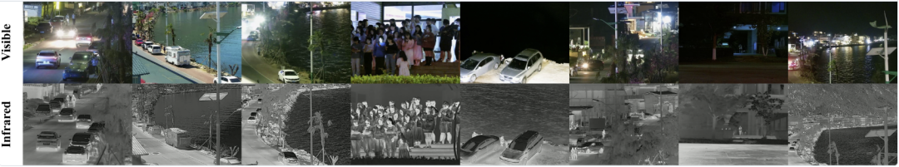

[在网页中查看](https://mmifusion.github.io/Datasets/#dataset=hdo)

---

### INO数据集

**标签：** 视频融合与视频资源

**发表团队：** INO（ The largest center of expertise in optics and photonics in Canada ）

**论文题目：** 未指定独立论文

**发表：** 不适用（官方数据资源，未指定期刊或会议） 参考博客： https://www.ino.ca/en/technologies/video-analytics-dataset/

**下载链接：** https://www.ino.ca/en/technologies/video-analytics-dataset/videos/

INO（加拿大国家光学研究所）发布的 Video Analytics Dataset 是一个专为多模态视频分析任务设计的高质量数据集，涵盖同步采集的 RGB 与热红外（LWIR）图像序列，适用于目标检测、图像融合与行为识别等研究。数据集包含多个真实场景的视频序列，如街道、停车场、建筑出入口和低光环境，具备良好的时间同步和像素级对齐特性，图像分辨率多样，帧率统一为 10fps，部分视频还包含雪天等恶劣天气条件。该数据集免费开放下载，为多光谱视觉算法的开发与验证提供了丰富且真实的测试资源。

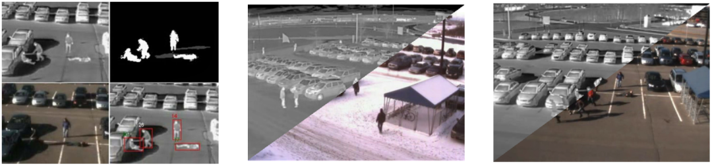

[在网页中查看](https://mmifusion.github.io/Datasets/#dataset=ino)

---

### OSU Color-Thermal数据集（经典彩色—热红外视频）

**标签：** 视频融合与视频资源

**发表团队：** 美国俄亥俄州立大学团队 @James W. Davis、Vinay Sharma

**论文题目：** Background-subtraction using contour-based fusion of thermal and visible imagery

**发表：** CVIU 2007

**论文链接：** https://doi.org/10.1016/j.cviu.2006.06.010

这篇论文使用彩色与热红外轮廓融合开展背景减除和目标检测。配套 OSU Color-Thermal 数据是 OTCBVS 集合中的 Dataset 03，包含校园道路交叉区域的 6 组彩色—热红外序列，图像大小为 320×240，并使用人工对应点和单应变换进行配准。该资源可作为早期 RGB-T 视频融合、背景建模及融合后检测的参考，不属于大规模现代融合训练集。

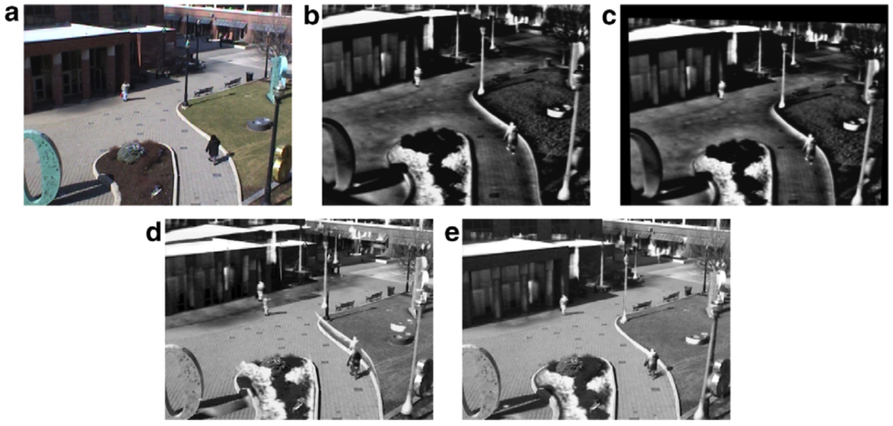

[在网页中查看](https://mmifusion.github.io/Datasets/#dataset=osu-color-thermal)

---

### MMVS数据集

**标签：** 视频融合与视频资源

**发表团队：** 云南师范大学-Yang Yang团队：Meng Sang、Housheng Xie、Yang Yang

**论文题目：** VRFF: Video Registration and Fusion Framework

**发表：** IJCNN 2024

**下载链接：** https://github.com/Meng-Sang/VRFF， https://github.com/Meng-Sang/MMVS

MMVS（Multi-modal Multi-scene Video Sequences）是一个专为夜间道路场景下红外与可见光视频融合与配准研究设计的多模态视频数据集。该数据集基于 FLIR 数据集整理而成，包含六组视频序列，每组包括红外视频、可见光视频以及手动对齐的红外-可见光图像对，每种类型的视频序列均包含 2151 帧图像。图像分辨率分别为红外图像 640×512 和可见光图像 1224×1024，图像格式为 JPG。该数据集特别关注低光照和强眩光等复杂环境下的图像融合与配准问题，为多模态视觉感知算法的开发与评估提供了高质量的测试资源。MMVS 数据集已在 GitHub 上开源，可供学术研究和非商业用途使用。

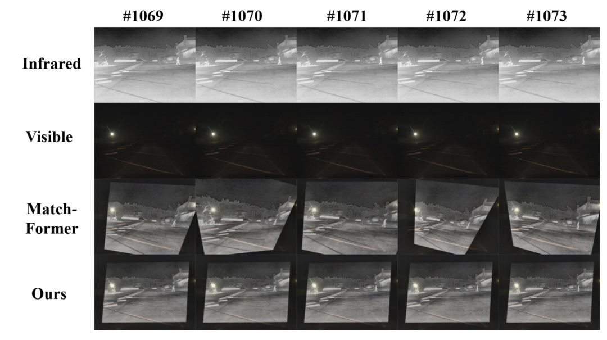

[在网页中查看](https://mmifusion.github.io/Datasets/#dataset=mmvs)

---

### M3SVD数据集

**标签：** 视频融合与视频资源

**发表团队：** 武汉大学-Jiayi Ma团队：Linfeng Tang、Yeda Wang、Meiqi Gong、Zizhuo Li、Yuxin Deng、Xunpeng Yi、Chunyu Li、Han Xu、Hao Zhang、Jiayi Ma

**论文题目：** VideoFusion: A Spatio-Temporal Collaborative Network for Multi-modal Video Fusion

**发表：** CVPR 2026

**下载链接：** https://github.com/Linfeng-Tang/M2VD

M3SVD 是红外—可见光视频数据集，面向多模态视频融合与恢复。原文介绍其包含 220 对时序同步、空间配准的视频，共 153,797 帧，覆盖公园、街道等日夜场景及遮挡、低光照和过曝等挑战，也支持退化条件下的视频融合研究。

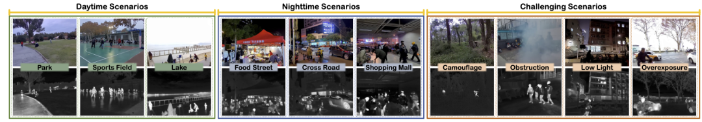

[在网页中查看](https://mmifusion.github.io/Datasets/#dataset=m3svd)

---

### VF-Bench数据集

**标签：** 视频融合与视频资源

**发表团队：** 苏黎世联邦理工学院+西安交通大学团队@Zixiang Zhao、Haowen Bai、Bingxin Ke、Yukun Cui、Lilun Deng、Yulun Zhang、Kai Zhang、Konrad Schindler

**论文题目：** A Unified Solution to Video Fusion: From Multi-Frame Learning to Benchmarking

**发表：** NeurIPS 2025

**下载链接：** https://github.com/Zhaozixiang1228/VF-Bench

VF-Bench 是视频融合评测基准，涵盖多曝光、多聚焦、红外—可见光和医学影像四类任务。数据分别基于 HDR 视频、DAVIS、VT-MOT 及 Harvard Medical 等资源整理或处理，多曝光和多聚焦场景涉及模拟生成，并配有时空融合评价指标。

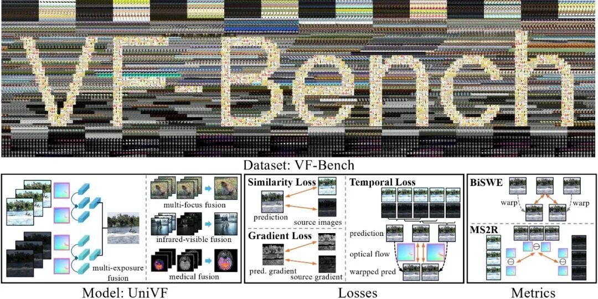

[在网页中查看](https://mmifusion.github.io/Datasets/#dataset=vf-bench)

---

### ELVID数据集（极低光照视频融合）

**标签：** 视频融合与视频资源

**发表团队：** USCFNet联合研究团队 @Cheng Zhao、Tianyun Song、Zhiliang Wu、Tianfu Wang、Moncef Gabbouj、Guanghui Yue、Baiying Lei、Wei Zhou

**论文题目：** Uncertainty-Guided Spatiotemporal Consistency Fusion Network for Infrared-Visible Video Fusion Under Extremely Low-Light Conditions

**发表：** TIP 2026

**论文链接：** https://doi.org/10.1109/TIP.2026.3719477

**下载链接：** https://github.com/Zhaocheng1/ELVID

这篇论文面向极低光照条件下的红外—可见光视频融合，构建 ELVID 数据集并提出 USCFNet。数据覆盖多类真实场景，用于评估暗光下的跨模态信息互补、视频时序一致性及不确定性处理能力。作者仓库提供 ELVID_npy.zip 下载入口，适合与常规视频融合数据配合使用，检验模型在可见光信息严重不足时的融合表现。

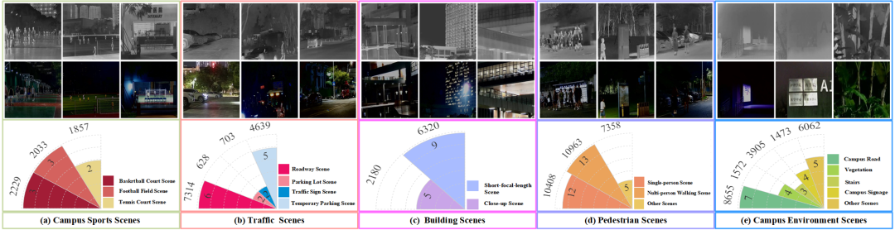

[在网页中查看](https://mmifusion.github.io/Datasets/#dataset=elvid)

---

### VLIRVDIF数据集（经典红外—可见光视频融合）

**标签：** 视频融合与视频资源

**发表团队：** 视频融合数据库联合研究团队 @Andreas Ellmauthaler、Carla L. Pagliari、Eduardo A. B. da Silva、Jonathan N. Gois、Sergio R. Neves

**论文题目：** A visible-light and infrared video database for performance evaluation of video/image fusion methods

**发表：** Multidim. Syst. Signal Process. 2019

**论文链接：** https://link.springer.com/article/10.1007/s11045-017-0548-y

**下载链接：** https://www02.smt.ufrj.br/~fusion/

这篇论文为图像与视频融合评估构建了可见光—红外视频数据库，并介绍跨光谱视频的标定、时间同步和空间配准流程。数据包含不同光照和场景条件，也涉及不同深度平面的非平面场景，适合研究动态融合及配准误差对融合结果的影响。它属于早期融合专用视频资源；当前原始下载入口尚未核实，暂以论文作为数据说明来源。

[在网页中查看](https://mmifusion.github.io/Datasets/#dataset=vlirvdif)

---

### VidLLVIP数据集（LLVIP视频衍生数据）

**标签：** 视频融合与视频资源 ｜ 衍生

**发表团队：** CMVF联合研究团队 @Jianfeng Ding、Hao Zhang、Zhongyuan Wang、Jinsheng Xiao、Xin Tian、Zhen Han、Jiayi Ma

**论文题目：** CMVF: Cross-modal unregistered video fusion via spatio-temporal consistency

**发表：** Inf. Fusion 2026

**论文链接：** https://doi.org/10.1016/j.inffus.2026.104212

**下载链接：** https://github.com/jianfeng0369/VidLLVIP

这篇论文研究未配准红外—可见光视频融合，作者后续发布了基于 LLVIP 原始视频加工的 VidLLVIP。该版本包含 894 对视频片段，每段约 5 秒，并提供时间同步、空间配准及数据处理说明，可用于视频融合、跨模态配准和时序一致性评测。VidLLVIP 属于第三方加工的 LLVIP 衍生数据，应同时引用 CMVF 和 LLVIP 原始论文，并检查与 LLVIP 图像划分之间的场景重叠。

[在网页中查看](https://mmifusion.github.io/Datasets/#dataset=vidllvip)

---

### KAIST数据集

**标签：** 目标检测与显著性检测

**发表团队：** Korea Advanced Institute of Science and Technology（韩国科学技术院，KAIST） @Soonmin Hwang、Jaesik Park、Namil Kim、Yukyung Choi、In So Kweon

**论文题目：** Multispectral pedestrian detection: Benchmark dataset and baseline

**发表：** CVPR 2015

**下载链接：** https://github.com/SoonminHwang/rgbt-ped-detection

KAIST Multispectral Pedestrian Dataset 是由韩国科学技术院（KAIST）构建的一个用于行人检测研究的大规模多光谱数据集。该数据集采用基于分光器的成像硬件，精确对齐了 RGB 与热红外图像，具备 95,328 对对齐的图像帧，涵盖白天与夜间的真实交通场景。数据集提供了超过 10 万个密集标注的行人实例，包含遮挡标签（无遮挡、部分遮挡、严重遮挡）和时间序列对应信息，适用于检测、跟踪和识别等任务。图像分辨率统一为 640×512，帧率为 20 fps，热成像通过 FLIR A35 设备采集。相比已有数据集，KAIST 数据集在数据规模、遮挡信息、时间一致性与色热对齐精度等方面具有显著优势，是研究多模态行人检测的基准数据集之一。

[在网页中查看](https://mmifusion.github.io/Datasets/#dataset=kaist)

---

### FLIR数据集

**标签：** 目标检测与显著性检测

**发表团队：** Teledyne FLIR

**论文题目：** 未指定独立论文

**发表：** 不适用（官方数据资源，未指定期刊或会议） 参考博客： FREE Teledyne FLIR Thermal Dataset for Algorithm Training

**下载链接：** https://www.flir.com/oem/adas/adas-dataset-form/

FLIR ADAS 数据集面向道路场景目标检测，原文列出 26,442 帧带边界框标注的图像，涵盖 15 类目标，包括热红外、可见光图像及配对视频帧。数据提供热图和可见光图像，采用 MS COCO 等标注格式；具体规模和划分应以所下载版本为准。

[在网页中查看](https://mmifusion.github.io/Datasets/#dataset=flir)

---

### FLIR-Aligned数据集（常用FLIR配准衍生版本／RGB—热红外融合）

**标签：** 目标检测与显著性检测 ｜ 衍生

**发表团队：** 法国雷恩大学／IRISA、南布列塔尼大学及 ATERMES 联合团队 @Heng Zhang、Elisa Fromont、Sébastien Lefèvre、Bruno Avignon；原始数据由 FLIR 发布

**论文题目：** Multispectral Fusion for Object Detection with Cyclic Fuse-and-Refine Blocks

**发表：** ICIP 2020

**论文链接：** https://arxiv.org/abs/2009.12664

**下载链接：** https://drive.google.com/file/d/1xHDMGl6HJZwtarNWkEV3T4O9X4ZQYz2Y/view

这篇论文研究多光谱目标检测，作者进一步公开了对原始 FLIR 可见光—热红外图像进行人工对齐后的版本。原始 FLIR 图像并非全部像素对齐，FLIR-Aligned 因而是开展像素级融合时应明确区分的常用版本。它属于本文已有 FLIR 的衍生数据，不是独立采集的新数据集；引用实验结果时应注明具体发布版本、图像数量及验证／测试协议。

[在网页中查看](https://mmifusion.github.io/Datasets/#dataset=flir-aligned)

---

### DVTOD数据集

**标签：** 目标检测与显著性检测

**发表团队：** 东北大学-Kechen Song, Yunhui Yan团队 @Kechen Song、Xiaotong Xue、Hongwei Wen、Yingying Ji、Yunhui Yan、Qinggang Meng

**论文题目：** Misaligned Visible-Thermal Object Detection: A Drone-Based Benchmark and Baseline

**发表：** TIV 2024

**下载链接：** https://github.com/VDT-2048/DVTOD

可见光-热成像图像对是通过无人机获取的未对齐图像，为研究人员研究未对齐的多光谱目标检测方法提供了基础。获取的图像对包含更具挑战性的属性，如雨、雪、雾、极端曝光、黑暗以及特殊材料遮挡，这些属性更符合真实世界的数据分布。该数据集的质量高于其他数据集的图像对，可见光图像的分辨率为1920×1080，热成像图像的分辨率为640×512。该数据集包含一天中不同时间段以及一年中所有季节的数据。

[在网页中查看](https://mmifusion.github.io/Datasets/#dataset=dvtod)

---

### RGBT-Tiny数据集

**标签：** 目标检测与显著性检测

**发表团队：** 国防科技大学@Xinyi Ying、Chao Xiao、Wei An、Ruojing Li、Xu He、Boyang Li、Xu Cao、Zhaoxu Li、Yingqian Wang、Mingyuan Hu、Qingyu Xu、Zaiping Lin、Miao Li、Shilin Zhou、Li Liu、Weidong Sheng

**论文题目：** Visible-Thermal Tiny Object Detection: A Benchmark Dataset and Baselines

**发表：** TPAMI 2025

**下载链接：** https://github.com/XinyiYing/RGBT-Tiny

RGBT-Tiny 面向可见光—热红外小目标检测，原文介绍其包含 115 对序列、约 93K 帧和约 120 万个人工标注，涵盖 7 类目标及多种场景。数据提供边界框和跟踪 ID，包含大量小于 16×16 像素的目标，支持小目标检测及相关时序研究。

[在网页中查看](https://mmifusion.github.io/Datasets/#dataset=rgbt-tiny)

---

### GTPLD电力线数据集

**标签：** 目标检测与显著性检测 Gorund_Truth_of_Power_Line_Dataset (Infrared-IR and Visible Light-VL)_512x512 (800)

**发表团队：** 埃斯基谢希尔技术大学@Ömer Emre Yetgin、Ömer Nezih Gerek

**论文题目：** Ground Truth of Powerline Dataset (Infrared-IR and Visible Light-VL)

**发表：** Mendeley Data 2019（数据集发布，非期刊或会议论文）

**下载链接：** https://www.selectdataset.com/dataset/4371a791b8e4090388449273a001dab8

GTPLD 是面向电力线检测的红外和可见光数据集，基于土耳其多地区航空视频提取图像。原文介绍其包含 400 张红外图像和 400 张可见光图像，缩放至 512×512，并提供电力线真值标注；场景覆盖不同季节、天气和光照条件。

[在网页中查看](https://mmifusion.github.io/Datasets/#dataset=gtpld)

---

### DroneVehicle数据集 (无人机 RGBT·目标检测)

**标签：** 目标检测与显著性检测

**发表团队：** 天津大学胡清华团队@Yiming Sun、Bing Cao、Pengfei Zhu、Qinghua Hu

**论文题目：** Drone-Based RGB-Infrared Cross-Modality Vehicle Detection Via Uncertainty-Aware Learning

**发表：** TCSVT 2022

**下载链接：** https://github.com/VisDrone/DroneVehicle

DroneVehicle 包含 28,439 对无人机采集的 RGB—红外图像，面向跨模态车辆检测，提供汽车、卡车、公交车、货车等五类目标的旋转框标注。原文说明下载图像四周有 100 像素白边，尺寸为 840×712，预处理可去除白边。

[在网页中查看](https://mmifusion.github.io/Datasets/#dataset=dronevehicle)

---

### RGBTDronePerson数据集 (无人机 RGBT·行人检测)

**标签：** 目标检测与显著性检测

**发表团队：** 武汉大学团队@Yan Zhang、Chang Xu、Wen Yang、Guangjun He、Huai Yu、Lei Yu、Gui-Song Xia

**论文题目：** Drone-based RGBT tiny person detection

**发表：** ISPRS J. Photogramm. Remote Sens. 2023

**下载链接：** https://nnnnerd.github.io/RGBTDronePerson/

这是一个基于无人机采集的跨模态行人检测数据集，名为 RGBTDronePerson。它由武汉大学团队构建，包含 6125 对 RGB（可见光）与 T（红外）图像，场景来自 50–80 米高空、多视角、多天气、多光照条件。RGB 图像分辨率为 1920×1080（后裁剪为 640×512），红外图像分辨率为 640×512。该数据集专注于极小目标检测，共标注 70,880 个实例，其中 98% 的目标小于 20 像素，并且存在明显的跨模态位置偏移，因此常用于研究 RGB–IR 融合检测、偏移对齐与小目标检测算法。

[在网页中查看](https://mmifusion.github.io/Datasets/#dataset=rgbtdroneperson)

---

### VT5000数据集 (RGBT·显著性目标检测)

**标签：** 目标检测与显著性检测

**发表团队：** 安徽大学团队@Zhengzheng Tu、Yan Ma、Zhun Li、Chenglong Li、Jieming Xu、Yongtao Liu

**论文题目：** RGBT Salient Object Detection: A Large-Scale Dataset and Benchmark

**发表：** TMM 2023

**下载链接：** https://github.com/lz118/RGBT-Salient-Object-Detection

VT5000 是 RGB-T 显著性目标检测数据集，包含 5,000 对可见光与热红外图像，并提供像素级显著性标注。数据覆盖不同目标尺度、光照和复杂背景，同时标注低照度、遮挡等挑战属性及模态成像质量信息。

[在网页中查看](https://mmifusion.github.io/Datasets/#dataset=vt5000)

---

### SMOD数据集 待更新

**标签：** 目标检测与显著性检测

**发表团队：** 上海交通大学团队 @Zizhao Chen、Yeqiang Qian、Xiaoxiao Yang、Chunxiang Wang、Ming Yang，来自上海交通大学自动化与感知学院及系统控制与信息处理教育部重点实验室。

**论文题目：** AMFD: Distillation via Adaptive Multimodal Fusion for Multispectral Pedestrian Detection

**发表：** TMM 2025

**下载链接：** https://github.com/bigD233/AMFD

SMOD 是面向多光谱目标检测的可见光—热红外数据集。原文介绍其包含 8,676 对图像，覆盖白天和夜间校园道路场景，标注行人、骑行者、自行车和汽车及遮挡程度；同时提供未配准图像对，可用于跨模态配准研究。

[在网页中查看](https://mmifusion.github.io/Datasets/#dataset=smod)

---

### VT821数据集（经典RGB-T显著性检测）

**标签：** 目标检测与显著性检测

**发表团队：** 安徽大学等联合研究团队 @Guizhao Wang、Chenglong Li、Yunpeng Ma、Aihua Zheng、Jin Tang、Bin Luo

**论文题目：** RGB-T Saliency Detection Benchmark: Dataset, Baselines, Analysis and a Novel Approach

**发表：** IGTA 2018

**论文链接：** https://arxiv.org/abs/1701.02829

**下载链接：** https://github.com/lz118/RGBT-Salient-Object-Detection

这篇论文构建包含 821 对 RGB—热红外图像及显著性真值的 VT821 基准，并标注多种挑战属性，用于 RGB-T 显著性目标检测研究。它与 VT1000、VT5000 构成常用的显著性检测数据系列，也可用于评估融合图像对显著目标感知的帮助。原始任务是显著性检测，用于像素级融合前需检查跨模态配准误差以及配准产生的边界黑边。

[在网页中查看](https://mmifusion.github.io/Datasets/#dataset=vt821)

---

### VT1000数据集（经典RGB-T显著性检测）

**标签：** 目标检测与显著性检测

**发表团队：** 安徽大学等联合研究团队 @Zhengzheng Tu、Tian Xia、Chenglong Li、Xiaoxiao Wang、Yan Ma、Jin Tang

**论文题目：** RGB-T Image Saliency Detection via Collaborative Graph Learning

**发表：** TMM 2020

**论文链接：** https://arxiv.org/abs/1905.06741

**下载链接：** https://github.com/lz118/RGBT-Salient-Object-Detection

这篇论文提出协同图学习的 RGB-T 显著性检测方法，并构建包含 1,000 对空间对齐 RGB—热红外图像及显著性标注的 VT1000 数据集。该资源适合与 VT821、VT5000 一起评估不同场景下的跨模态互补与显著性检测表现，也可用于融合后的下游评测。将其用于图像融合时，应区分显著性真值和融合图像真值，两者并不相同。

[在网页中查看](https://mmifusion.github.io/Datasets/#dataset=vt1000)

---

### UVT20K数据集（真实未对齐RGB-T数据）

**标签：** 目标检测与显著性检测

**发表团队：** 安徽大学研究团队 @Kunpeng Wang、Keke Chen、Chenglong Li、Zhengzheng Tu、Bin Luo

**论文题目：** Alignment-Free RGB-T Salient Object Detection: A Large-Scale Dataset and Progressive Correlation Network

**发表：** AAAI 2025

**论文链接：** https://ojs.aaai.org/index.php/AAAI/article/view/32838

**下载链接：** https://github.com/Angknpng/PCNet

这篇论文面向免配准 RGB-T 显著性检测构建 UVT20K，包含 20,000 对未对齐图像，并提供显著性掩码、涂鸦、边界与挑战属性标注。数据覆盖低照度、背景杂乱和复杂显著目标等真实情况，可作为未配准融合及融合后显著性评测的扩展资源。其输入本身存在跨模态错位，不能不经处理直接当作严格配准的常规融合训练集。

[在网页中查看](https://mmifusion.github.io/Datasets/#dataset=uvt20k)

---

### MS（东京大学Multi-spectral Object Detection）数据集（经典RGB—多波段红外目标检测／融合扩展）

**标签：** 目标检测与显著性检测

**发表团队：** 东京大学原田达也团队 @Takumi Karasawa、Kohei Watanabe、Qishen Ha、Antonio Tejero-De-Pablos、Yoshitaka Ushiku、Tatsuya Harada

**论文题目：** Multispectral Object Detection for Autonomous Vehicles

**发表：** ACM MM Workshops 2017

**论文链接：** https://doi.org/10.1145/3126686.3126727

**下载链接：** https://www.mi.t.u-tokyo.ac.jp/projects/mil_multispectral/index.html

这篇论文研究自动驾驶中的多光谱目标检测，发布同时包含可见光与多个红外波段的图像及目标标注，论文将四种模态记为 RGB、NIR、MIR 和 FIR。该经典资源可补充不同光谱条件下的融合与融合后检测评测，但其原始定位是目标检测，进行像素级融合时需核对所用数据版本的配准关系。它与同一项目页中的 MFNet、本文已有的 MSRS 和 SMOD 均为不同条目，因此单独补充，并注明完整名称以避免缩写混淆。

[在网页中查看](https://mmifusion.github.io/Datasets/#dataset=ms)

---

### SWVI（亦见SWVID）数据集（恶劣天气RGB—红外融合扩展／目标检测）

**标签：** 目标检测与显著性检测

**发表团队：** 浙江工业大学、湖南大学、南加州大学联合团队 @Haoyuan Li、Qi Hu、Binjia Zhou、You Yao、Jiacheng Lin、Kailun Yang、Peng Chen

**论文题目：** CFMW: Cross-Modality Fusion Mamba for Robust Object Detection Under Adverse Weather

**发表：** TCSVT 2025

**论文链接：** https://doi.org/10.1109/TCSVT.2025.3587918

**下载链接：** https://huggingface.co/datasets/lhy-zju/SWVI/tree/main

这篇论文面向恶劣天气下的多模态目标检测，构建含雨、雾、雪退化条件的可见光—红外数据。SWVI 可作为恢复融合、天气鲁棒性及融合后检测的扩展评测资源，但原始任务是目标检测，天气退化基于已有图像构造，不能写成全部实采恶劣天气。SWVI 与 SWVID 在相关资料中作为同一资源的名称变体出现，本清单合并收录。

[在网页中查看](https://mmifusion.github.io/Datasets/#dataset=swvi)

---

### LasHeR数据集（主流RGB-T单目标跟踪）

**标签：** 目标跟踪与人群计数

**发表团队：** 安徽大学研究团队 @Chenglong Li、Wanlin Xue、Yaqing Jia、Zhichen Qu、Bin Luo、Jin Tang、Dengdi Sun

**论文题目：** LasHeR: A Large-Scale High-Diversity Benchmark for RGBT Tracking

**发表：** TIP 2022

**论文链接：** https://arxiv.org/abs/2104.13202

**下载链接：** https://github.com/BUGPLEASEOUT/LasHeR

这篇论文构建大规模 RGB-T 单目标跟踪基准 LasHeR，包含 1,224 对可见光—热红外视频序列、超过 73 万帧对，并提供逐帧目标框标注，覆盖多种目标、视角、天气和光照条件。作者还提供未对齐版本，用于研究更接近真实场景的跨模态跟踪。该数据可拓展视频融合及融合后跟踪研究，使用时应注明具体版本并核查空间对应关系。

[在网页中查看](https://mmifusion.github.io/Datasets/#dataset=lasher)

---

### RGBT234数据集（经典RGB-T单目标跟踪）

**标签：** 目标跟踪与人群计数

**发表团队：** 安徽大学等联合研究团队 @Chenglong Li、Xinyan Liang、Yijuan Lu、Nan Zhao、Jin Tang

**论文题目：** RGB-T object tracking: Benchmark and baseline

**发表：** PR 2019

**论文链接：** https://doi.org/10.1016/j.patcog.2019.106977

**下载链接：** https://github.com/mmic-lcl/mmic-lcl.github.io/blob/master/_code-dataset/dataset.md

这篇论文提出 RGB-T 跟踪基准 RGBT234，包含 234 对可见光—热红外视频序列，提供目标标注、挑战属性及相应评测方法。它是 RGB-T 单目标跟踪的经典资源，可与 LasHeR 以及无人机跟踪数据配合使用，研究跨场景鲁棒性和融合后跟踪表现。该数据的主要评价对象是目标跟踪，目标框对应不应直接等同于整幅图像严格逐像素对齐。

[在网页中查看](https://mmifusion.github.io/Datasets/#dataset=rgbt234)

---

### VTUAV数据集 (无人机 RGBT·目标追踪)

**标签：** 目标跟踪与人群计数

**发表团队：** 大连理工大学团队@Pengyu Zhang、Jie Zhao、Dong Wang、Huchuan Lu、Xiang Ruan

**论文题目：** Visible-Thermal UAV Tracking: A Large-Scale Benchmark and New Baseline

**发表：** CVPR 2022

**下载链接：** https://github.com/zhang-pengyu/DUT-VTUAV

VTUAV 是无人机可见光—热红外目标跟踪数据集，原文介绍其包含 500 条视频序列和 1,664,549 对图像，覆盖行人、车辆、动物、船只等目标及多种昼夜场景。数据支持短时与长时跟踪，并提供挑战属性等标注。

[在网页中查看](https://mmifusion.github.io/Datasets/#dataset=vtuav)

---

### VT-MOT数据集

**标签：** 目标跟踪与人群计数

**发表团队：** 安徽大学、安徽理工大学@Yabin Zhu、Qianwu Wang、Chenglong Li、Jin Tang、Chengjie Gu、Zhixiang Huang

**论文题目：** Visible–thermal multiple object tracking: Large-scale video dataset and progressive fusion approach

**发表：** PR 2025

**下载链接：** https://github.com/wqw123wqw/PFTrack

VT-MOT 面向可见光—热红外多目标跟踪，包含自主采集的手持、无人机和监控视频，以及从 RGBT234、LasHeR、VTUAV 筛选并重新标注的数据。原文介绍其有 582 段序列、约 401k 帧对和 399 万个标注框，训练与测试分别为 462 和 120 段。

[在网页中查看](https://mmifusion.github.io/Datasets/#dataset=vt-mot)

---

### RGBT-CC数据集（RGB-T人群计数）

**标签：** 目标跟踪与人群计数

**发表团队：** 中山大学、安徽大学等联合团队 @Lingbo Liu、Jiaqi Chen、Hefeng Wu、Guanbin Li、Chenglong Li、Liang Lin

**论文题目：** Cross-Modal Collaborative Representation Learning and a Large-Scale RGBT Benchmark for Crowd Counting

**发表：** CVPR 2021

**论文链接：** https://openaccess.thecvf.com/content/CVPR2021/html/Liu_Cross-Modal_Collaborative_Representation_Learning_and_a_Large-Scale_RGBT_Benchmark_for_CVPR_2021_paper.html

**下载链接：** https://lingboliu.com/RGBT_Crowd_Counting.html

这篇论文构建 RGBT-CC 人群计数基准，包含 2,030 对 RGB—热红外图像及 138,389 个人员标注，并提出跨模态协同表示学习方法。该数据为清单补充人群计数任务，可用于检验可见光与热红外互补信息对人员感知的作用，亦可作为融合图像下游计数评测的扩展资源。标注主要服务计数与密度估计，不是理想融合图像的监督真值。

[在网页中查看](https://mmifusion.github.io/Datasets/#dataset=rgbt-cc)

---

### LGHD

**标签：** 配准、匹配与拼接

**发表团队：** 西班牙 Computer Vision Center（CVC）/ Universitat Autònoma de Barcelona（UAB）团队 @Cristhian A. Aguilera、Angel D. Sappa、Ricardo Toledo

**论文题目：** LGHD: A feature descriptor for matching across non-linear intensity variations

**发表：** ICIP 2015

**下载链接：** https://github.com/ngunsu/LGHD

LGHD 是用于多模态图像匹配的局部特征描述方法，并非单一数据集。论文在 RGB—深度、RGB—长波红外、闪光—非闪光和 RGB—近红外四类图像上评估，原文列出分别为 4、44、120 和 58 对，可用于跨模态特征匹配研究。

[在网页中查看](https://mmifusion.github.io/Datasets/#dataset=lghd)

---

### IVSD数据集

**标签：** 配准、匹配与拼接

**发表团队：** 大连海事大学+大连理工大学团队@Zhiying Jiang、Zengxi Zhang、Jinyuan Liu、Xin Fan、Risheng Liu

**论文题目：** Multispectral Image Stitching via Global-Aware Quadrature Pyramid Regression

**发表：** TIP 2024

**下载链接：** https://github.com/Jzy2017/MSGA PS：提出了一个高质量的红外与可见光图像拼接数据集，应该是第一个提出图像拼接+图像融合的任务。看模型图感觉是要先做一个图像拼接到全景图像，然后基于拼接的全景图像进行融合。

本文构建了一个用于多光谱图像拼接评估的真实场景红外–可见光数据集。该数据集由多光谱成像设备从不同视角连续采集获得，红外与可见光传感器间距为4 cm，可见光图像分辨率为1024×768，红外图像为640×512（波长范围8–14 μm）。作者通过相机内参校正与手动配准消除视差，使红外与可见光图像在同一视角下实现一对一对应，并裁剪为896×640以去除非重叠区域。最终数据集包含300对红外–可见光图像，覆盖29个室内外场景，具有多样的光照条件（白天、傍晚、夜间）和不同的重叠率与视差，能够全面评估多光谱图像拼接方法在复杂环境下的性能。

[在网页中查看](https://mmifusion.github.io/Datasets/#dataset=ivsd)

---

### RIVIR数据集

**标签：** 配准、匹配与拼接

**发表团队：** 大连理工大学团队 @Jinyuan Liu、Zengxi Zhang、Jiahao Zhang、Zhiying Jiang、Long Ma、Xin Fan、Risheng Liu，合作单位还包括东京大学、大连海事大学等。

**论文题目：** Universal Representation for Real-World Misaligned Infrared-Visible Image Fusion

**发表：** TPAMI 2026

**下载链接：** https://github.com/ZengxiZhang/URMIF

RIVIR（Real-world Infrared and Visible Image Registration Dataset） 是面向真实世界未对齐红外-可见光图像配准与融合构建的大规模数据集。官方代码仓库当前给出的版本共包含 1,300 对真实未对齐红外-可见光图像，采用 FLIR T1050sc 双光谱相机采集，其中可见光图像分辨率为 1280×960，红外图像分辨率为 1024×768。数据采集覆盖多个城市，地理范围横跨约 26° 经度和 18° 纬度，以增强不同地域、场景和成像条件下的数据多样性。数据集针对真实场景中的视差、视场差异及复杂几何错位问题设计，并提供相应的配准真值，可用于红外与可见光图像配准、未对齐图像融合以及真实场景跨模态视觉研究。

[在网页中查看](https://mmifusion.github.io/Datasets/#dataset=rivir)

---

### ATR-UMMIM／ATR-UMMIR数据集（无人机红外—可见光配准／配准与融合联合研究）

**标签：** 配准、匹配与拼接

**发表团队：** 国防科技大学电子科学学院团队 @Kangcheng Bin、Chen Chen、Ting Hu、Jiahao Qi、Ping Zhong

**论文题目：** ATR-UMMIM: A Benchmark Dataset for UAV-Based Multimodal Image Registration under Complex Imaging Conditions

**发表：** arXiv 2025（预印本）

**论文链接：** https://arxiv.org/abs/2507.20764

**下载链接：** https://github.com/supercpy/ATR-UMMIR

这篇论文介绍 7,969 组三元组，每组包含原始可见光、红外和配准后的可见光图像，覆盖不同航高、拍摄角度、时间与天气，并提供成像条件和目标标注。它可用于跨模态配准、未配准融合及融合后检测。配准图像是真实空间对应关系的参考，不是融合结果真值；ATR-UMMIM 与 ATR-UMMIR 应作为同一论文资源的名称差异记录，不能重复计为两个数据集。

[在网页中查看](https://mmifusion.github.io/Datasets/#dataset=atr-ummim-atr-ummir)

---

### OUCR数据集（无人机海事RGB—红外配准／需申请获取）

**标签：** 配准、匹配与拼接 ｜ 需申请获取

**发表团队：** 中国海洋大学信息科学与工程学部、青岛 Willand Intelligent Technology 联合团队 @Zhenyi Li、Xiaogang Yang、Tianxu Zhao、Shengke Wang

**论文题目：** Fusion-oriented registration of UAV-acquired RGB–infrared images for maritime target detection and segmentation

**发表：** Intell. Mar. Technol. Syst. 2026

**论文链接：** https://doi.org/10.1007/s44295-026-00103-9 论文页面（数据获取方式待确认）： https://doi.org/10.1007/s44295-026-00103-9

这篇论文面向海事目标检测和分割，研究无人机 RGB—红外图像的融合导向配准，并构建含 602 对图像的 OUCR 数据，采集平台为 DJI M3T，场景位于青岛海岸。该资源适合检验跨模态目标对齐及其对下游融合感知的影响；原始定位是配准与检测／分割，并非带融合真值的通用图像融合基准。

[在网页中查看](https://mmifusion.github.io/Datasets/#dataset=oucr)

---

### RGBT550K数据集

**标签：** 多模态感知及扩展任务

**发表团队：** 南京大学-Linsen Chen、Xun Cao @Kailai Zhou、Fuqiang Yang、Shixian Wang、Bihan Wen、Chongde Zi、Linsen Chen、Qiu Shen、Xun Cao

**论文题目：** M-SpecGene: Generalized Foundation Model for RGBT Multispectral Vision

**发表：** ICCV 2025

**下载链接：** https://github.com/CalayZhou/M-SpecGene

RGBT550K 是从已有 RGBT 资源筛选得到的多任务图像集合。原文介绍作者从 41 个数据集汇集约 300 万对样本，再通过来源均衡、视频抽帧和质量筛选，得到 548,238 对 RGB—热红外图像，可用于预训练及检测、分割、跟踪等任务。

[在网页中查看](https://mmifusion.github.io/Datasets/#dataset=rgbt550k)

---

### UniMod1K数据集

**标签：** 多模态感知及扩展任务

**发表团队：** 江南大学吴小俊团队@Xue-Feng Zhu、Tianyang Xu、Zongtao Liu、Zhangyong Tang、Xiao-Jun Wu、Josef Kittler

**论文题目：** UniMod1K: Towards a More Universal Large-Scale Dataset and Benchmark for Multi-modal Learning

**发表：** IJCV 2024

**下载链接：** https://github.com/xuefeng-zhu5/UniMod1K

UniMod1K 是 RGB、深度和语言多模态数据集，原文介绍其包含 1,050 段 RGB-D 视频、约 250 万帧，并为视频提供自然语言描述。训练集和测试集分别为 1,000 和 50 段，覆盖多种室内外场景与目标，可用于多模态跟踪等研究。

[在网页中查看](https://mmifusion.github.io/Datasets/#dataset=unimod1k)

---

### MMVIP 数据集

**标签：** 多模态感知及扩展任务

**发表团队：** 广东工业大学团队 @Yunpeng Yin，作者包括 Yunpeng Yin、Lihan Wang、Zhaoshen He、Xinqiang He、Xingming Liao、Zhuowei Wang、Lianglun Cheng

**论文题目：** MMVIP: A Visible-infrared Paired Dataset for Multi-weather Marine Vision

**发表：** CVPR 2026

**下载链接：** https://github.com/yyppptjr/MMVIP

MMVIP 是面向复杂海洋环境构建的大规模可见光-红外配对海事视觉数据集，主要解决现有红外与可见光数据集集中于城市道路场景、缺乏真实海洋环境及多天气条件的问题。数据集共包含 128,100 张可见光与红外图像以及 50 段视频序列，所有跨模态数据均经过精确的时空对齐。Conftrace 数据采集覆盖 晴天、阴天、夜间、雨天、雾天、低照度和台风等 7 类天气条件，能够反映海面低纹理、强光反射、低照度以及恶劣天气等复杂海事环境。Graphastra 数据集不仅可用于红外与可见光图像融合，还针对跨模态图像配准、海上目标检测以及可见光-红外图像转换等任务建立了统一 benchmark，为多天气条件下的海洋多模态视觉研究提供了较为系统的大规模数据基础。

[在网页中查看](https://mmifusion.github.io/Datasets/#dataset=mmvip)

---

### DSERT-RoLL五模态数据集

**标签：** 多模态感知及扩展任务

**发表团队：** KAIST Visual Intelligence Lab（VILAB）团队 @Hoonhee Cho、Jae-Young Kang、Yuhwan Jeong、Yunseo Yang、Wonyoung Lee、Youngho Kim、Kuk-Jin Yoon，其中 Hoonhee Cho、Jae-Young Kang、Yuhwan Jeong 为共同第一作者。

**论文题目：** DSERT-RoLL: Robust Multi-Modal Perception for Diverse Driving Conditions with Stereo Event-RGB-Thermal Cameras, 4D Radar, and Dual-LiDAR

**发表：** CVPR 2026

**下载链接：** https://jeongyh98.github.io/dsert-roll/

DSERT-RoLL 是一个面向复杂驾驶环境的多模态自动驾驶数据集，共包含约 22K 组同步数据，集成了双目 RGB、双目事件相机、双目热红外相机、4D Radar、长距离 LiDAR、短距离 LiDAR 以及 GPS/IMU。数据采集覆盖晴天、雾天、小雨、大雨、小雪和大雪等多种天气，以及正常光照、低照度、过曝和 HDR 等不同照明条件。数据集提供精确的 2D/3D 边界框、目标 Track ID 和自车里程计信息，可用于多模态 2D/3D 目标检测、传感器融合以及恶劣天气下的鲁棒自动驾驶感知研究。其核心特点是同时包含 RGB、Event、Thermal、4D Radar 和双 LiDAR，便于在统一场景下比较不同传感器及其组合在复杂天气和光照条件下的性能与互补性。

[在网页中查看](https://mmifusion.github.io/Datasets/#dataset=dsert-roll)

---

### CarlaOcc 八类标注数据集

**标签：** 多模态感知及扩展任务

**发表团队：** 同济大学团队 @Yi Feng、Junwu E、Zizhan Guo、Yu Ma、Hanli Wang、Rui Fan，其中 Yi Feng 与 Junwu E 为共同第一作者，Rui Fan 为通讯作者；团队主要来自同济大学电子与信息工程学院、同济大学上海自主智能无人系统科学中心，并与西安交通大学人机混合增强智能全国重点实验室合作。

**论文题目：** An Instance-Centric Panoptic Occupancy Prediction Benchmark for Autonomous Driving

**发表：** CVPR 2026

**下载链接：** https://mias.group/CarlaOcc/

CarlaOcc 是基于 CARLA 构建的自动驾驶三维全景占据预测仿真数据集。原文介绍其包含超过 100K 帧，提供多相机 RGB、深度、语义、激光雷达及多尺度占据标注，支持三维场景理解和语义、实例级占据预测。

[在网页中查看](https://mmifusion.github.io/Datasets/#dataset=carlaocc)

---

### AerialMetric数据集

**标签：** 多模态感知及扩展任务

**发表团队：** 中山大学深圳校区团队 @Zhongqiang Song、Guanying Chen，联合鹏城实验室相关研究机构、香港中文大学（深圳）以及电子科技大学团队；作者包括 Zhongqiang Song、Guanying Chen、Yuqi Zhang、Yin Zou、Chuanyu Fu、Zhiyuan Yuan、Chuan Huang、Shuguang Cui、Xiaochun Cao，其中 Guanying Chen 为通讯作者。

**论文题目：** AerialMetric: Benchmarking and Adapting UAV Monocular Metric Depth Estimation in the Real World

**发表：** ECCV 2026

**下载链接：** https://kuieless.github.io/AerialMetric-ECCV2026-page/

AerialMetric 是无人机单目度量深度估计基准。原文介绍其包含约 52K 对真实图像—深度数据和 16K 对合成数据，涵盖斜视、受控采集、合成与野外四个子集，以及不同高度、视角和场景，可用于深度估计与空中视觉研究。

[在网页中查看](https://mmifusion.github.io/Datasets/#dataset=aerialmetric)

---

### DarkAct数据集

**标签：** 多模态感知及扩展任务

**发表团队：** 武汉大学、哈尔滨工业大学联合团队 @Yuanjun Tan、Aoran Xiao、Liqian Deng、Zhigang Tu，其中 Yuanjun Tan 与 Aoran Xiao 为共同第一作者，Zhigang Tu 为通讯作者。

**论文题目：** DarkAct: A RGB-Thermal Dataset and Fusion Framework for Multimodal Low-Light Action Recognition

**发表：** CVPR 2026

DarkAct 是低光照人体动作识别数据集，原文介绍其包含 12,778 对 RGB—热红外视频、27 类动作，总时长约 19.2 小时；训练集和测试集分别为 9,040 对和 3,738 对。数据覆盖不同光照、视角与室内外场景。

[在网页中查看](https://mmifusion.github.io/Datasets/#dataset=darkact)

---

### InfraParis数据集（RGB—红外—深度多任务感知扩展）

**标签：** 多模态感知及扩展任务

**发表团队：** ENSTA Paris U2IS、巴黎萨克雷大学及 Safran 联合团队 @Gianni Franchi、Marwane Hariat、Xuanlong Yu、Nacim Belkhir、Antoine Manzanera、David Filliat

**论文题目：** InfraParis: A multi-modal and multi-task autonomous driving dataset

**发表：** WACV 2024

**论文链接：** https://arxiv.org/abs/2309.15751

**下载链接：** https://ensta-u2is-ai.github.io/infraParis/

这篇论文发布面向自动驾驶的 InfraParis，联合提供 RGB、红外与深度信息，支持语义分割、目标检测和深度估计。对红外—可见光融合研究而言，它可作为带有下游任务信息的扩展场景，用于检验融合表征或融合图像对道路感知的帮助。其原始定位是多模态多任务感知，开展像素级图像融合前需核对具体版本的跨相机几何关系与对齐处理。

[在网页中查看](https://mmifusion.github.io/Datasets/#dataset=infraparis)

---

### MIT Sea Grant Marine Perception（RoboWhaler）数据集（海事RGB—热红外原始多传感器数据／融合扩展）

**标签：** 多模态感知及扩展任务

**发表团队：** 麻省理工学院 Sea Grant AUV 实验室、马萨诸塞大学洛厄尔分校联合团队 @Michael DeFilippo、Michael Sacarny、Paul Robinette

**论文题目：** RoboWhaler: A Robotic Vessel for Marine Autonomy and Dataset Collection

**发表：** OCEANS 2021

**论文链接：** https://oceanai.mit.edu/pavlab/docs/OCEANS21-2021157455.pdf

**下载链接：** https://seagrant.mit.edu/auvlab-datasets-marine-perception-1/MIT

这篇论文介绍用于海洋自主航行与数据采集的 RoboWhaler 平台，记录海事环境中的多传感器观测。其可见光和热红外数据为海事图像融合提供场景来源，但使用时需要按时间戳抽取对应帧，并核对标定、视场重叠和空间配准。它与热红外分割数据 MassMIND 的任务和发布形式不同，也不应与本文已有的 MIV、MMVS 混为同一数据集。

[在网页中查看](https://mmifusion.github.io/Datasets/#dataset=mit-sea-grant-marine-perception)

---

### Condition-Embedded Visible-Infrared（典型地物条件嵌入）数据集（原创采集／带环境条件的可见光—热红外配对／融合扩展）

**标签：** 多模态感知及扩展任务

**发表团队：** 长沙学院、国防科技大学、Dongguan South Semiconductor Technology Company Ltd 联合团队 @Huang Zhijian、Hui Bingwei、Ma Yanxin、Yang Zhichao、Zhang Shengxian

**论文题目：** Condition-Embedded Visible-Infrared image dataset for typical ground features

**发表：** Sci. Data 2026

**论文链接：** https://doi.org/10.1038/s41597-026-06847-7

**下载链接：** https://www.scidb.cn/s/B363M3

这篇论文发布 2022—2024 年独立采集的 22,435 对可见光—红外图像，覆盖晴、阴、雨、雪、雾等天气及水体、林地、草地、沙地、农田、建筑、道路、裸地八类典型地物，并记录温度、湿度和太阳角度等条件。采集结合移动平台与长期固定站点，经过配准、裁剪和尺度统一。其主要定位是条件感知的可见光到红外图像转换，也可作为真实环境条件下融合研究的扩展数据；这属于原创采集后的常规配准处理，不是对其他公开数据集重新配准形成的衍生版本。

[在网页中查看](https://mmifusion.github.io/Datasets/#dataset=condition-embedded-visible-infrared)

---

## 多聚焦图像融合

### Lytro数据集（经典多聚焦图像融合）

**标签：** 多聚焦融合与评测

**发表团队：** 伊斯法罕理工大学、麦克马斯特大学联合团队 @Mansour Nejati、Shadrokh Samavi、Shahram Shirani

**论文题目：** Multi-focus image fusion using dictionary-based sparse representation

**发表：** Inf. Fusion 2015

**论文链接：** https://doi.org/10.1016/j.inffus.2014.10.004

**下载链接：** https://github.com/mnnejati/LytroDataset

这篇论文提出基于字典稀疏表示的多聚焦融合方法，并提供经典 Lytro 多聚焦图像资源。作者仓库包含 20 对 520×520 彩色多聚焦图像，以及 4 组每组含 3 张源图像的序列，可用于评估全聚焦重建、聚焦区域选择和边界融合效果。其输入来自不同焦点设置，属于多源多聚焦融合，不是红外—可见光融合。

[在网页中查看](https://mmifusion.github.io/Datasets/#dataset=lytro)

---

### MFI-WHU数据集（经典多聚焦图像融合）

**标签：** 多聚焦融合与评测

**发表团队：** 武汉大学等联合研究团队 @Hao Zhang、Zhuliang Le、Zhenfeng Shao、Han Xu、Jiayi Ma

**论文题目：** MFF-GAN: An unsupervised generative adversarial network with adaptive and gradient joint constraints for multi-focus image fusion

**发表：** Inf. Fusion 2021

**论文链接：** https://doi.org/10.1016/j.inffus.2020.08.022

**下载链接：** https://github.com/HaoZhang1018/MFI-WHU

这篇论文提出 MFF-GAN 多聚焦图像融合方法，配套 MFI-WHU 数据集包含 120 对图像。作者说明构造数据所用的全清晰源图像来自公开数据资源，因此应注明其衍生构造属性。该基准可用于多聚焦融合算法比较，重点检验不同清晰区域及清晰—模糊过渡边界的保留，与 Lytro 等真实多聚焦测试数据形成补充。

[在网页中查看](https://mmifusion.github.io/Datasets/#dataset=mfi-whu)

---

### MFIFB数据集（经典多聚焦融合评测基准）

**标签：** 多聚焦融合与评测

**发表团队：** 英国帝国理工学院研究团队 @Xingchen Zhang

**论文题目：** Multi-focus Image Fusion: A Benchmark

**发表：** arXiv 2020（预印本）

**论文链接：** https://arxiv.org/abs/2005.01116

**下载链接：** https://github.com/xingchenzhang/MFIFB

这篇论文提出多聚焦图像融合评测基准 MFIFB，整合 105 对测试图像、30 种融合算法和 20 项评价指标，为不同方法提供统一比较平台。基准同时提供相应代码与融合结果，适合复现实验、评价指标分析和多聚焦算法横向比较。它属于汇集测试样本与算法工具的综合基准，使用时应注意与其他多聚焦数据集之间可能存在样本重叠。

[在网页中查看](https://mmifusion.github.io/Datasets/#dataset=mfifb)

---

### Real-MFF数据集（经典多聚焦图像融合／带参考真值）

**标签：** 多聚焦融合与评测

**发表团队：** 清华大学深圳国际研究生院、香港科技大学、伦敦大学学院联合团队 @Juncheng Zhang、Qingmin Liao、Shaojun Liu、Haoyu Ma、Wenming Yang、Jing-Hao Xue

**论文题目：** Real-MFF: A large realistic multi-focus image dataset with ground truth

**发表：** PRL 2020

**论文链接：** https://doi.org/10.1016/j.patrec.2020.08.002

**下载链接：** https://github.com/Zancelot/Real-MFF

这篇论文发布带参考真值的 Real-MFF 多聚焦融合数据，基于光场图像构建 710 对具有不同聚焦区域的源图像及对应参考结果，覆盖建筑、植物、人物等多种真实场景。它为监督训练和有参考质量评价提供了条件，可补充 Lytro 等较小规模评测集。该资源属于同一成像模态下的多聚焦融合，是图像融合领域的经典扩展，不属于红外—可见光配对数据；具体训练、测试划分应以所采用实验协议为准。

[在网页中查看](https://mmifusion.github.io/Datasets/#dataset=real-mff)

---

### MFFW（Multi-focus Fusion in the Wild）数据集（经典多聚焦图像融合／散焦扩散挑战）

**标签：** 多聚焦融合与评测

**发表团队：** 西安交通大学数学与统计学院团队 @Shuang Xu、Xiaoli Wei、Chunxia Zhang、Junmin Liu、Jiangshe Zhang

**论文题目：** MFFW: A new dataset for multi-focus image fusion

**发表：** arXiv 2020（预印本）

**论文链接：** https://arxiv.org/abs/2002.04780

**下载链接：** https://www.researchgate.net/publication/350965471_MFFW

这篇论文构建 MFFW，收集并配准 19 对来自互联网的多聚焦图像，其中散焦扩散效应（defocus spread effect）明显、场景较复杂，适合检验融合方法在清晰与模糊区域交界处的处理能力。作者仅为部分图像对提供聚焦图和参考图像，因此不能将其写成全部带真值的大规模训练集。它是对 Lytro、Real-MFF 等多聚焦资源的挑战性评测补充，属于经典小规模测试数据。

[在网页中查看](https://mmifusion.github.io/Datasets/#dataset=mffw)

---

### Road-MF数据集

**标签：** 多聚焦融合与评测

**发表团队：** 佛山大学团队 @Xilai Li、Xiaosong Li、Haishu Tan、Jinyang Li。

**论文题目：** SAMF: Small-Area-Aware Multi-Focus Image Fusion for Object Detection

**发表：** ICASSP 2024

**下载链接：** https://github.com/ixilai/SAMF

Road-MF 是面向真实道路场景多聚焦图像融合（Multi-Focus Image Fusion, MFIF）构建的数据集，共包含 80 对真实多聚焦图像，主要以道路及车辆等自动驾驶场景为采集对象。arXiv 与 Lytro、MFI-WHU 等传统多聚焦融合数据集相比，Road-MF 更强调真实道路环境中的复杂目标及不同景深问题，使近距离和远距离目标可能分别处于清晰或离焦状态。该数据集尤其关注车辆之间的行人等小区域目标，用于评估融合算法对小聚焦区域、边界区域以及复杂道路目标细节的保留能力。融合后的全聚焦图像还可直接用于 YOLOv5 目标检测等下游视觉任务，从而评估多聚焦图像融合对自动驾驶目标感知性能的影响。

[在网页中查看](https://mmifusion.github.io/Datasets/#dataset=road-mf)

---

## 多曝光图像融合

### SICE数据集（经典多曝光图像资源）

**标签：** 多曝光融合与评测

**发表团队：** 香港理工大学等研究团队 @Jianrui Cai、Shuhang Gu、Lei Zhang

**论文题目：** Learning a Deep Single Image Contrast Enhancer from Multi-Exposure Images

**发表：** TIP 2018

**论文链接：** https://csjcai.github.io/papers/SICE.pdf

**下载链接：** https://github.com/csjcai/SICE

这篇论文原本研究单图像对比度增强，并构建了包含 589 个高分辨率多曝光序列、共 4,413 张图像的数据资源。作者利用多种多曝光融合和高动态范围成像算法生成候选参考结果，再通过主观筛选确定参考图像。SICE 的多曝光序列被用于多曝光融合与曝光增强研究，使用时应说明选取的子集、输入曝光数量和参考图像来源。

[在网页中查看](https://mmifusion.github.io/Datasets/#dataset=sice)

---

### MEF Subjective Database数据集（经典多曝光融合质量评价）

**标签：** 多曝光融合与评测

**发表团队：** 加拿大滑铁卢大学团队 @Kede Ma、Kai Zeng、Zhou Wang

**论文题目：** Perceptual Quality Assessment for Multi-Exposure Image Fusion

**发表：** TIP 2015

**论文链接：** https://ece.uwaterloo.ca/~z70wang/publications/TIP_MEF_SSIM.pdf

**下载链接：** https://ivc.uwaterloo.ca/database/MEF/MEF-Database.html

这篇论文建立多曝光融合主观评价数据库，并提出面向融合结果的感知质量评价方法。数据包含多曝光源序列、不同方法生成的融合结果及主观评价信息，适合研究多曝光融合质量评价和算法比较。该资源以评测为主要用途，与用于大规模模型训练的数据集定位不同；使用时应采用其对应的主观评分和评价协议。

[在网页中查看](https://mmifusion.github.io/Datasets/#dataset=mef-subjective-database)

---

### MEFB数据集（经典多曝光融合评测基准）

**标签：** 多曝光融合与评测

**发表团队：** 英国帝国理工学院研究团队 @Xingchen Zhang

**论文题目：** Benchmarking and comparing multi-exposure image fusion algorithms

**发表：** Inf. Fusion 2021

**论文链接：** https://www.sciencedirect.com/science/article/pii/S1566253521000233

**下载链接：** https://github.com/xingchenzhang/MEFB

这篇论文提出多曝光图像融合评测基准 MEFB，包含 100 对测试图像、21 种算法、20 项评价指标、2,100 张融合结果及软件工具。其主要作用是统一多曝光融合方法的测试输入与评价流程，方便复现和横向比较。MEFB 与 MEF Subjective Database 是不同资源：前者侧重算法测试平台，后者侧重融合结果的主观质量评价。

[在网页中查看](https://mmifusion.github.io/Datasets/#dataset=mefb)

---

### ExpoMotion数据集

**标签：** 多曝光融合与评测

**发表团队：** 南开大学团队 @Yao Liu、Lishen Qu、Shihao Zhou、Jie Liang、Hui Zeng、Yabin Peng、Huipeng Lin、Lei Zhang、Jufeng Yang，合作单位包括南开大学计算机学院、南开深圳福田国际先进研究院、OPPO Research Institute、香港理工大学、鹏城实验室等。

**论文题目：** ExpoMotion: A Large-Scale Benchmark and A Householder Projection Network for Multi-Exposure Fusion

**发表：** ECCV 2026

**下载链接：** https://github.com/Leo-LiuYao/ExpoMotion

ExpoMotion 面向动态场景多曝光图像融合，原文介绍其包含 1,738 个序列、10,909 张图像，涵盖不同曝光和运动条件。训练集与受控运动测试集提供参考图像，真实动态测试集不提供参考图像，可用于融合和运动鬼影抑制评测。

[在网页中查看](https://mmifusion.github.io/Datasets/#dataset=expomotion)

---

## 遥感与光谱图像

### PanCollection数据集（经典遥感全色锐化资源集合）

**标签：** 全色锐化、高光谱与多光谱

**发表团队：** 电子科技大学邓良剑研究团队等 @Xiao Wu、Liang-Jian Deng、Ran Ran；所列论文作者：Liang-jian Deng、Gemine Vivone、Mercedes E. Paoletti、Giuseppe Scarpa、Jiang He、Yongjun Zhang、Jocelyn Chanussot、Antonio Plaza

**论文题目：** Machine Learning in Pansharpening: A benchmark, from shallow to deep networks

**发表：** GRSM 2022

**论文链接：** https://liangjiandeng.github.io/papers/2022/review-grsm2022.pdf

**下载链接：** https://github.com/XiaoXiao-Woo/PanCollection

这篇论文系统比较全色锐化机器学习方法；PanCollection 项目进一步整理相关数据和实现，提供 WorldView-3、QuickBird、GaoFen-2、WorldView-2 等传感器数据的训练测试资源。任务是将高空间分辨率全色图像与多光谱图像融合，获得高分辨率多光谱结果。PanCollection 是资源集合，不是单次独立采集的数据集，实验需注明具体传感器、版本和评价设置。

[在网页中查看](https://mmifusion.github.io/Datasets/#dataset=pancollection)

---

### PanScale数据集

**标签：** 全色锐化、高光谱与多光谱

**发表团队：** 中国科学院合肥物质科学研究院、中国科学技术大学团队 @Ke Cao，联合香港科技大学、香港大学、厦门大学、京东、浙江大学等单位；作者包括 Ke Cao、Xuanhua He、Xueheng Li、Lingting Zhu、Yingying Wang、Ao Ma、Zhanjie Zhang、Man Zhou、Chengjun Xie、Jie Zhang，其中 Ke Cao 与 Xuanhua He 为共同第一作者，Man Zhou、Jie Zhang 为通讯作者。

**论文题目：** Cross-Scale Pansharpening via ScaleFormer and the PanScale Benchmark

**发表：** CVPR 2026

**下载链接：** https://github.com/caoke-963/ScaleFormer

PanScale 是面向跨尺度全色锐化的遥感数据集，原文介绍其由 Jilin-1、Landsat-9 和 SkySat 三个子集组成，共约 7,559 对多光谱与全色图像，覆盖多个地区和场景。数据提供训练集及多尺度降分辨率、全分辨率测试集。

[在网页中查看](https://mmifusion.github.io/Datasets/#dataset=panscale)

---

### CAVE多光谱数据集（经典高光谱—多光谱图像融合）

**标签：** 全色锐化、高光谱与多光谱

**发表团队：** 哥伦比亚大学 CAVE 与索尼联合团队 @Fumihito Yasuma、Tomoo Mitsunaga、Daisuke Iso、Shree K. Nayar

**论文题目：** Generalized Assorted Pixel Camera: Postcapture Control of Resolution, Dynamic Range, and Spectrum

**发表：** TIP 2010

**论文链接：** https://cave.cs.columbia.edu/Statics/publications/pdfs/Yasuma_IP10.pdf

**下载链接：** https://cave.cs.columbia.edu/repository/Multispectral

这篇论文研究广义混合像素相机，其配套 CAVE 多光谱数据库包含 32 个场景，图像尺寸为 512×512，覆盖 400–700 nm 的 31 个光谱波段。该数据被广泛用于高光谱—多光谱图像融合与光谱超分辨率研究，常从原始光谱立方体模拟低空间分辨率高光谱和高空间分辨率多光谱输入。使用时应报告空间退化核、光谱响应及场景划分；它不属于热红外—可见光融合数据。

[在网页中查看](https://mmifusion.github.io/Datasets/#dataset=cave)

---

### Harvard真实场景高光谱数据集（经典高光谱—RGB／多光谱融合）

**标签：** 全色锐化、高光谱与多光谱

**发表团队：** 哈佛大学工程与应用科学学院团队 @Ayan Chakrabarti、Todd Zickler

**论文题目：** Statistics of real-world hyperspectral images

**发表：** CVPR 2011

**论文链接：** https://vision.seas.harvard.edu/papers/Hyperspec_CVPR2011.pdf

**下载链接：** https://vision.seas.harvard.edu/hyperspec/download.html

这篇论文研究真实场景高光谱图像的空间—光谱统计特性，并发布包含 50 幅日光场景图像及补充人工或混合光照场景的数据。每幅图像包含 420–720 nm 的 31 个波段，常用于高光谱—RGB／多光谱融合实验，融合输入通常由原始光谱数据模拟获得。它与本文原有的 Harvard 多模态医学图像数据库是两个不同资源，因此新增独立条目，并明确标注“真实场景高光谱”。

[在网页中查看](https://mmifusion.github.io/Datasets/#dataset=harvard)

---

### Chikusei数据集（经典遥感高光谱—多光谱融合）

**标签：** 全色锐化、高光谱与多光谱

**发表团队：** 东京大学空间应用实验室团队 @Naoto Yokoya、Akira Iwasaki

**论文题目：** Airborne hyperspectral data over Chikusei

**发表：** Tech. Rep. 2016（技术报告）

**论文链接：** http://park.itc.u-tokyo.ac.jp/sal/hyperdata/TechRepSAL20160527.pdf

**下载链接：** https://naotoyokoya.com/Download.html

这篇论文（数据技术报告）介绍的 Chikusei 由机载高光谱传感器于 2014 年在日本筑西市采集，覆盖农业与城市区域，包含 2517×2335 像素、363–1018 nm 的 128 个波段，地面采样距离为 2.5 米。它是高光谱—多光谱遥感融合的经典评测资源，常采用模拟空间降采样与光谱响应构造融合输入。实验应说明退化模型及互不重叠的训练、测试区域，避免同一大图的空间信息泄漏。

[在网页中查看](https://mmifusion.github.io/Datasets/#dataset=chikusei)

---

### WHU-OPT-SAR光学—SAR遥感数据集

**标签：** 全色锐化、高光谱与多光谱

**发表团队：** 武汉大学团队@Xue Li、Guo Zhang、Hao Cui、Shasha Hou、Shunyao Wang、Xin Li、Yujia Chen、Zhijiang Li、Li Zhang

**论文题目：** MCANet: A joint semantic segmentation framework of optical and SAR images for land use classification

**发表：** Int. J. Appl. Earth Obs. Geoinf. 2022

**下载链接：** https://github.com/AmberHen/WHU-OPT-SAR-dataset

WHU-OPT-SAR 是光学—SAR 联合土地利用分类数据集，使用高分一号光学影像与高分三号 SAR 影像，覆盖湖北省约 5 万平方公里。原文介绍其包含 100 幅 5556×3704 像素的光学影像及对应区域 SAR 影像，并提供像素级标注。

[在网页中查看](https://mmifusion.github.io/Datasets/#dataset=whu-opt-sar-sar)

---

### M4-SAR 光学–SAR 融合目标检测数据集

**标签：** 光学–SAR 融合目标检测 ｜ 多分辨率 ｜ 多极化 ｜ 多场景 ｜ 多源

**发表团队：** Lei Luo、Jian Yang 团队@南京理工大学，联合安徽大学、南开大学

**论文题目：** M4-SAR: A Multi-Resolution, Multi-Polarization, Multi-Scene, Multi-Source Dataset and Benchmark for optical-SAR Object Detection

**发表：** ECCV 2026

**论文链接：** https://arxiv.org/abs/2505.10931

**下载链接：** https://github.com/wchao0601/M4-SAR

**代码仓库：** https://github.com/wchao0601/M4-SAR

这篇论文针对光学–SAR融合目标检测缺乏大规模、标准化数据集的问题，构建了M4-SAR数据集。光学图像具有丰富的纹理、颜色和语义信息，但容易受到弱光、云层遮挡等因素影响；SAR图像具备全天时、全天候成像能力，却存在散斑噪声和语义表达不足等问题。M4-SAR围绕两种模态的互补特性，为复杂环境下的遥感目标检测提供配对数据和统一评测基础。数据集基于Sentinel-1和Sentinel-2卫星的公开数据构建，具有多分辨率、多极化、多场景和多源四个特点，共包含112,174对实例级对齐的光学–SAR图像，以及981,862个带有方向信息的目标实例，覆盖6类目标。图像尺寸统一为512×512像素，包含10米、60米两种光学空间分辨率及VH、VV两种SAR极化方式。在标注过程中，研究利用光学图像丰富的语义信息辅助SAR目标标注，并采用半监督策略提升标注质量，为跨模态融合与旋转目标检测研究提供支持。

[在网页中查看](https://mmifusion.github.io/Datasets/#dataset=m4-sar)

---

## 医学与显微图像

### Harvard多模态医学图像数据集

**标签：** 医学与显微图像融合

**发表团队：** 哈佛大学团队@Keith A. Johnson, M.D and J. Alex Becker, Ph.D

**论文题目：** 未指定独立论文

**发表：** 不适用（在线图谱，未指定期刊或会议）

**官方链接：** https://www.med.harvard.edu/aanlib/home.html

**三方下载：** https://github.com/yidamyth/Havard-Medical-Image-Fusion-Datasets

The Whole Brain Atlas 是由哈佛医学院（Harvard Medical School）开发的一个高质量神经影像公开数据库，主要用于脑部结构与病理研究及医学教学。该数据集涵盖多模态影像，包括 MRI、PET、SPECT 和 MRA 等，展示了从正常脑结构到多种脑部疾病（如中风、肿瘤、阿尔茨海默病、多发性硬化等）的影像特征。所有图像均经过严格配准和整理，具备良好的空间一致性与可视化交互功能，为神经影像学分析、多模态医学图像融合和病理诊断研究提供了标准化参考数据。

[在网页中查看](https://mmifusion.github.io/Datasets/#dataset=harvard-105)

---

### GFP数据集 (绿色荧光蛋白·相差显微镜图像)

**标签：** 医学与显微图像融合

**发表团队：** John Innes Centre and Wheat Improvement Centre-Syngenta团队@Olga A. Koroleva、Matthew L. Tomlinson、David Leader、Peter Shaw、John H. Doonan

**论文题目：** High-throughput protein localization in Arabidopsis using Agrobacterium-mediated transient expression of GFP-ORF fusions

**发表：** Plant J. 2005

**下载链接：** https://data.jic.ac.uk/Gfp/

该 GFP 数据集来源于 John Innes Centre 的高通量亚细胞定位研究，共构建了 170 个 GFP 融合蛋白表达克隆，其中 155 个样本获得了可检测的绿色荧光信号。每个样本均包含 GFP 荧光显微图像（用于显示蛋白定位）和 相差显微图像（PC）（用于提供细胞结构背景），可用于多模态细胞表型分析。论文中提供了所有成功表达样本的代表性显微图像，但未说明具体的图像数量与分辨率；全部原始图像可从 JIC GFP 数据库在线获取。因此，该数据集可视为一个包含 155 组 GFP–PC 显微图对的多模态细胞成像数据资源，为蛋白定位、细胞结构识别和生物显微图像分析提供了可靠依据。

[在网页中查看](https://mmifusion.github.io/Datasets/#dataset=gfp)

---

## 其他模态与任务

### RGB-NIR Scene Dataset数据集

**标签：** 近红外、短波红外及 RGB-D

**发表团队：** 洛桑联邦理工学院@ Matthew Brown and Sabine Süsstrunk

**论文题目：** Multi-spectral SIFT for scene category recognition

**发表：** CVPR 2011

**下载链接：** https://www.epfl.ch/labs/ivrl/research/downloads/rgb-nir-scene-dataset/

RGB-NIR Scene Dataset 由瑞士洛桑联邦理工学院 IVRL 发布，包含 477 组可见光与近红外场景图像，覆盖乡村、森林、城市、水域等 9 类场景。图像经过配准，常用版本为 1024×768 TIFF，可用于多光谱处理和场景分类。

[在网页中查看](https://mmifusion.github.io/Datasets/#dataset=rgb-nir-scene-dataset)

---

### IVIFormer配套RGB–SWIR数据集（可见光—短波红外融合）

**标签：** 近红外、短波红外及 RGB-D

**发表团队：** 延世大学智能技术联合团队 @Incheol Park、Youngwan Jin、Yagiz Nalcakan、Hyeongjin Ju、Sanghyeop Yeo、Shiho Kim

**论文题目：** IVIFormer: Illumination-Aware Infrared-Visible Image Fusion via Adaptive Domain-Switching Cross Attention

**发表：** ICCVW 2025

**论文链接：** https://doi.org/10.1109/ICCVW69036.2025.00234

**下载链接：** https://yonsei-stl.github.io/IVIFormer/

这篇论文除评测常见长波红外融合数据外，还采集了 2,390 对 RGB–SWIR 图像，覆盖城市道路、隧道及雨天等场景，用于研究光照变化下的可见光—短波红外互补融合。项目页给出原始记录分辨率为 1826×1085，并按 8∶2 划分训练和测试数据。SWIR 与常见热红外 LWIR 的成像特性不同，因此这里单独标注波段；该条目属于论文已介绍、数据开放状态待确认的资源。

[在网页中查看](https://mmifusion.github.io/Datasets/#dataset=iviformer-rgb-swir)

---

### VN-Haze数据集（原创采集／可见光—近红外融合去雾）

**标签：** 近红外、短波红外及 RGB-D

**发表团队：** VN-Haze／保色融合去雾研究团队 @Jing Wu、Peng Wei、Feng Huang

**论文题目：** Color-preserving visible and near-infrared image fusion for removing fog

**发表：** Infrared Phys. Technol. 2024

**论文链接：** https://doi.org/10.1016/j.infrared.2024.105252

**下载链接：** https://www.sciencedirect.com/science/article/pii/S1350449524001361

这篇论文为融合去雾新采集并配准不同雾霾条件下的可见光—近红外图像，构建 VN-Haze，以补充既有 RGB–NIR 数据中雾天样本不足的问题。论文将该数据与已有数据结合评测，但 VN-Haze 本身被描述为新增雾天拍摄数据，而非在旧清晰图像上合成雾。它直接服务于保色融合去雾；其红外模态为近红外 NIR，不能与常规长波热红外 RGB–T 数据混为同一成像类型。

[在网页中查看](https://mmifusion.github.io/Datasets/#dataset=vn-haze)

---

### RGBD1K数据集

**标签：** 近红外、短波红外及 RGB-D

**发表团队：** 江南大学吴小俊团队@Xue-Feng Zhu、Tianyang Xu、Zhangyong Tang、Zucheng Wu、Haodong Liu、Xiao Yang、Xiao-Jun Wu、Josef Kittler

**论文题目：** RGBD1K: A Large-Scale Dataset and Benchmark for RGB-D Object Tracking

**发表：** AAAI 2023

**下载链接：** https://github.com/xuefeng-zhu5/RGBD1K

RGBD1K 是 RGB-D 目标跟踪数据集，原文介绍其包含 1,050 段视频、约 250 万帧，其中 1,000 段用于训练、50 段用于测试。数据覆盖 100 多类目标和多种室内外场景，提供目标框与挑战属性标注，可用于 RGB-D 跟踪评测。

[在网页中查看](https://mmifusion.github.io/Datasets/#dataset=rgbd1k)

---
